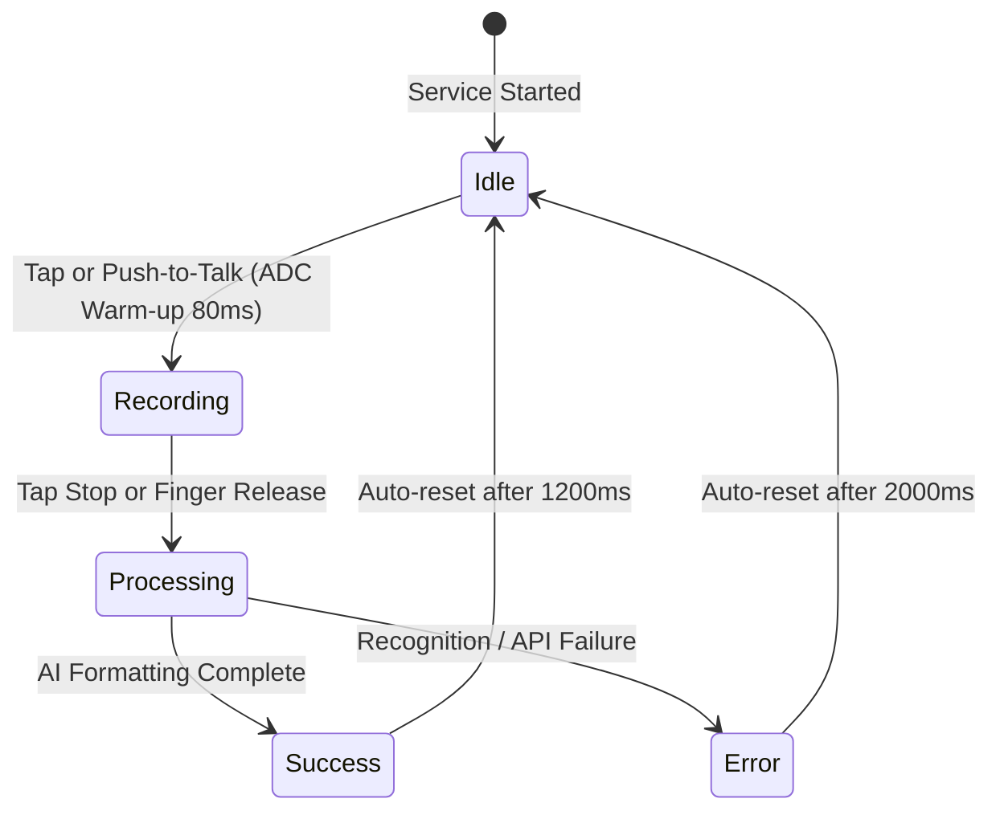
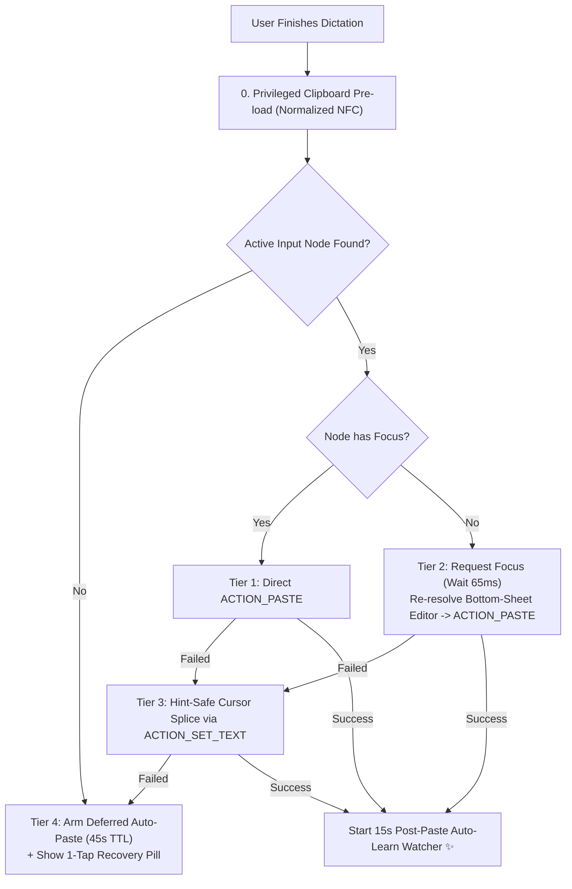

# Flow (Wispr Flow Replacement for Android) — Complete UI, Visual Design & Interaction Specification

> **Target Version**: Flow v3.3.0 (Build 10)  
> **Design Philosophy**: Modern Dark Obsidian Slate, Neumorphic Depth, Wispr Flow Ambient Overlay UX  
> **Primary Audience**: UI/UX Designers, Frontend Engineers, and AI LLMs (Claude, ChatGPT, Gemini) seeking an immediate, pixel-exact mental model of Flow's interface, visual hierarchy, animations, and runtime behaviors.

---

## 1. Design System & Design Tokens

Flow is crafted around a cohesive **Obsidian Dark Palette** (Tailwind Slate / Material 3 dark tokens) tailored for high-contrast legibility on OLED/AMOLED displays, ensuring ultra-low battery consumption while maintaining vibrant state indicators.

### 1.1 Color Palette & Semantic Roles

| Token Name | Hex Code | Compose / ARGB | Semantic Usage & Context |
| :--- | :--- | :--- | :--- |
| **`BackgroundDark`** | `#0F172A` | `Color(0xFF0F172A)` | Scaffold background, system status bar, navigation bar, master canvas backdrop. |
| **`SurfaceDark`** | `#1E293B` | `Color(0xFF1E293B)` | Primary card backgrounds, bottom navigation bar, alert dialog surfaces, floating badge background. |
| **`SurfaceCard`** | `#334155` | `Color(0xFF334155)` | Elevated inner containers, input borders, dividers, chip backgrounds, inactive radio surfaces. |
| **`PrimaryBlue`** | `#1E3A8A` | `Color(0xFF1E3A8A)` | Idle state color of the floating mic bubble, setup buttons, primary action accents. |
| **`PrimaryBlueVariant`** | `#172554` | `Color(0xFF172554)` | Active Master Toggle card background, highlighted surface containers. |
| **`AccentCyan`** | `#0284C7` | `Color(0xFF0284C7)` | Primary interactive accent, selected radio borders, text links, active sliders, switch tracks. |
| **`AccentCyanBorder`** | `#06B6D4` | `Color(0xFF06B6D4)` | 1-Tap recovery pill border, focus halos, vector rim badges. |
| **`SuccessGreen`** | `#059669` | `Color(0xFF059669)` | Mic bubble success state (checkmark), granted permission checks, successful connectivity tests. |
| **`RecordingRed`** | `#DC2626` | `Color(0xFFDC2626)` | Mic bubble recording state, voice amplitude aura glow, permission warnings, clear history actions. |
| **`DismissRed`** | `#E11D48` | `Color(0xFFE11D48)` | Drag-to-dismiss bottom target when mic is hovering in proximity (`isNear = true`). |
| **`ProcessingAmber`**| `#D97706` | `Color(0xFFD97706)` | Mic bubble processing state (spinner), "✨ Auto-learned" badges, "Undo AI Edit" buttons. |
| **`TextPrimary`** | `#F8FAFC` | `Color(0xFFF8FAFC)` | High-emphasis headers, active button labels, primary dictation transcripts. |
| **`TextSecondary`** | `#94A3B8` | `Color(0xFF94A3B8)` | Subtitles, helper text, timestamps, inactive icons, placeholder descriptions. |

---

### 1.2 Typography & Text Hierarchy

Flow uses the device system font (Roboto on Android / Google Sans on Pixel / Noto Sans Bengali for Bengali characters). All typography scales follow Material 3 type standards:

| Role | Font Size | Font Weight | Line Height | Color | Sample Element |
| :--- | :--- | :--- | :--- | :--- | :--- |
| **Display Header** | `20.sp` | `FontWeight.Bold` | `28.sp` | `TextPrimary` | TopAppBar App Title (`Flow`) |
| **Section Header** | `16.sp` | `FontWeight.Bold` | `24.sp` | `TextPrimary` | Card Titles (`Auto Cleanup`, `Engine Mode`) |
| **Card Subtitle** | `12.sp` | `FontWeight.Normal` | `16.sp` | `TextSecondary` | Feature descriptions, guidance notes |
| **Item Title** | `13.sp`–`14.sp` | `FontWeight.Bold` | `18.sp` | `TextPrimary` / `AccentCyan` | Snippet triggers, radio option labels |
| **Body Content** | `15.sp` | `FontWeight.Normal` | `22.sp` | `TextPrimary` | History transcripts, text preview |
| **Caption / Badge**| `9.sp`–`11.sp` | `FontWeight.SemiBold`| `14.sp` | `ProcessingAmber` / `AccentCyan` | `✨ Auto-learned` badge, timestamp |

---

### 1.3 Shapes, Borders & Elevation

- **Card Outer Corners**: `RoundedCornerShape(16.dp)` to `RoundedCornerShape(20.dp)` (pill-soft modern aesthetic).
- **Inner Item Corners**: `RoundedCornerShape(8.dp)` to `RoundedCornerShape(12.dp)` (buttons, chips, list items).
- **Borders**: Crisp `1.5.dp` solid stroke with `SurfaceCard` (`#334155`) for unselected items; `1.5.dp` `AccentCyan` (`#0284C7`) for selected items.
- **Elevation**: Minimalist flat/subtle elevation (`0.dp` to `2.dp`) on cards; `16.dp` on the floating 1-tap recovery pill to float distinctly above keyboard.

---

## 2. The Floating Overlay / Mic Bubble (Signature Wispr Flow UX)

The floating overlay is managed by `FloatingBubbleService` through Android's `WindowManager` using a custom vector canvas view (`FloatingMicCanvasView`). It floats over all third-party apps (WhatsApp, Messenger, YouTube, Google Keep, Chrome, Xiaomi Notes).

```
        ┌────────────────────────────────┐
        │                                │
        │     ((((  ╭────────╮  ))))     │  <-- Pulsing Reactive Aura (0..22% radius expansion)
        │           │  ╭──╮  │           │  
        │           │  │  │  │           │  <-- Vector Microphone Capsule
        │           │  ╰──╯  │           │
        │           │  ╰──╯  │  ╭────╮   │  <-- Mic Cradle & Stem
        │           │   ──   │  │ বাং │   │  <-- Rim Language Badge (Bottom-Right, 20% radius)
        │           ╰────────╯  ╰────╯   │
        │                                │
        └────────────────────────────────┘
```

### 2.1 Geometry & Window Parameters
- **Window Type**: `WindowManager.LayoutParams.TYPE_APPLICATION_OVERLAY`.
- **Window Flags**: `FLAG_NOT_FOCUSABLE or FLAG_NOT_TOUCH_MODAL or FLAG_WATCH_OUTSIDE_TOUCH`.
  - *Crucial UX Behavior*: Tapping, dragging, or talking into the floating mic **never steals keyboard input focus** from the underlying app (e.g., YouTube comments or Facebook post dialogs stay active).
- **Default Position**: Bottom-right margin, roughly `55%` of screen height (`y = 0.55 * screenHeight`), `24dp` from the right edge.
- **Configurable Dimensions**: Slider adjustable from `48 dp` to `84 dp` (default: **`64 dp`**).
- **Configurable Opacity**: Slider adjustable from `30%` to `100%` (default: **`90%`**).

---

### 2.2 Visual Progression Across 5 Core States

The floating bubble transitions seamlessly across 5 distinct states:



| State | Background Fill | Border | Center Graphic | Dynamic Animation | Haptic Feedback |
| :--- | :--- | :--- | :--- | :--- | :--- |
| **1. Idle** | Deep Royal Blue (`#1E3A8A`) | `2.5dp` Crisp White (`#FFFFFF`) | Crisp White Vector Microphone Capsule & Cradle | Static; waits for touch | None |
| **2. Recording** | Vibrant Red (`#DC2626`) | `2.5dp` Crisp White (`#FFFFFF`) | Crisp White Vector Microphone | **Dynamic Voice Aura**: Outward translucent red ring expanding up to `+22%` of radius based on live mic amplitude (`voiceAmplitude` 0.0..1.0) | 1 short haptic tick (60ms) |
| **3. Processing** | Warm Amber (`#D97706`) | `2.5dp` Crisp White (`#FFFFFF`) | Rotating Vector Arc Spinner (`270°` arc) | Smooth infinite 360° rotation (`900ms` cycle) | Double haptic tick (40ms / 40ms) |
| **4. Success** | Emerald Green (`#059669`) | `2.5dp` Crisp White (`#FFFFFF`) | Animated Vector Checkmark Path | Renders checkmark, text pasted into active app | Subtle success vibration pattern |
| **5. Error** | Crimson Red (`#B91C1C`) | `2.5dp` Crisp White (`#FFFFFF`) | Vector Microphone with toast message | Red outline pulse | Error vibration pattern |

---

### 2.3 Rim Language Badge (`বাং` / `EN`)
- Attached to the **bottom-right rim** of the floating bubble at `(x = 0.76 * w, y = 0.76 * h)`.
- **Badge Shape**: Circular, radius `20%` of parent bubble.
- **Badge Fill**: Dark Slate `#1E293B`, with a `2dp` pure white outer stroke.
- **Badge Text**: Bold white centered text (`বাং` for Bengali, `EN` for English).
- **Interaction**: **Double-tapping** the bubble triggers a crisp haptic buzz and switches the STT language immediately between Bengali and English without opening the main app!

---

### 2.4 Messenger-Style Bottom Drag-to-Dismiss (`✕ Remove`)

```
               [ Floating Mic (Dragging Down) ]
                             │
                             ▼
               ┌──────────────────────────┐
               │         ╭──────╮         │
               │         │  ✕   │         │  <-- Dismiss Target View (64dp circle)
               │         ╰──────╯         │      Normal: Slate (#D90F172A)
               │                          │      Near (<90dp): Crimson (#E11D48)
               └──────────────────────────┘
```

1. Dragging the mic activates a circular target overlay at the bottom center of the screen (`y = 48dp` from screen bottom).
2. **Proximity Haptics**: When the mic moves within `90dp` of the target:
   - Target scales up to `1.2x`.
   - Background transitions from Slate (`#D90F172A`) to Crimson Red (`#E11D48`) with light rose stroke (`#FDA4AF`).
   - Phone emits a subtle warning haptic.
3. Releasing inside the target dismisses the mic overlay cleanly.
4. **Restoration**: The persistent notification updates to show **`[Show Mic / মাইক দেখান]`**—tapping it returns the mic immediately.

---

### 2.5 Real-Time Speech Preview Pill & 1-Tap Recovery Banner

- **Live Preview Pill**:
  - Located at bottom-center (`y = 90dp` above navigation bar).
  - Background: Translucent obsidian `#EE0F172A` with slate border `#475569`, corner radius `16dp`.
  - Displays streaming live speech recognition text throttled to `250ms` updates.
- **1-Tap Recovery Banner (Zero Word Loss)**:
  - If Flow finishes dictating while no text field is currently focused (e.g. YouTube bottom-sheet comment dialog closed unexpectedly):
  - A pill banner pops up at the top-center (`y = 60dp`, cyan border `#06B6D4`, corner radius `20dp`):
    - *Bangla*: `📋 লেখাটি কপি হয়েছে — কমেন্ট বক্সে ট্যাপ করলেই বসে যাবে`
    - *English*: `📋 Copied — Tap comment box to paste`
  - Tapping the banner triggers immediate paste injection!

---

## 3. Main Application Architecture (`MainActivity.kt`)

Built natively using **Jetpack Compose with Material 3**, supporting instantaneous bilingual switching (English $\leftrightarrow$ বাংলা) without restarting the activity.

```
┌─────────────────────────────────────────────────────────────┐
│ ≡ Flow                      [EN | বাংলা]  [ ? Help ]        │ <-- TopAppBar
├─────────────────────────────────────────────────────────────┤
│ ╭─────────────────────────────────────────────────────────╮ │
│ │ ⚡ Floating Mic is Active                  [ Switch: ON] │ │ <-- Master Toggle Card
│ │ Floating button is active above keyboard                │ │
│ ╰─────────────────────────────────────────────────────────╯ │
│                                                             │
│ ╭─────────────────────────────────────────────────────────╮ │
│ │ ✔ All Required Permissions Granted                      │ │ <-- Permissions Card
│ │ Overlay (Granted) • Accessibility (Active)              │ │
│ ╰─────────────────────────────────────────────────────────╯ │
│                                                             │
│ ╭─────────────────────────────────────────────────────────╮ │
│ │ ⚙ Engine Mode                                            │ │ <-- Engine Mode Selector
│ │  (•) Cloud Audio (gemini-3.5-transcribe) (Recommended)  │ │
│ │  ( ) Hybrid Cloud Polish (Google STT + LLM)             │ │
│ │  ( ) Offline Gemma 3 1B LLM                             │ │
│ ╰─────────────────────────────────────────────────────────╯ │
│                                                             │
│ ╭─────────────────────────────────────────────────────────╮ │
│ │ 🪄 Auto Cleanup & Backtrack (Wispr Flow)                │ │ <-- Auto Cleanup Card
│ │  ( ) None (Verbatim)                                    │ │
│ │  ( ) Light (Strict Dictation)                           │ │
│ │  (•) Medium (Wispr Flow Magic ✨)                       │ │
│ │  ─────────────────────────────────────────────────────  │ │
│ │  Casual Messaging: Drop Trailing Period   [ Switch: ON] │ │
│ ╰─────────────────────────────────────────────────────────╯ │
│                                                             │
│ ╭─────────────────────────────────────────────────────────╮ │
│ │ 📖 Personal Dictionary & Auto-Learn ✨         [ + Add ] │ │ <-- Dictionary Card
│ │  • Sylhet (Replaces: Silhet)                            │ │
│ │  • Ihtesham  [✨ Auto-learned]                          │ │
│ ╰─────────────────────────────────────────────────────────╯ │
│                                                             │
│ ╭─────────────────────────────────────────────────────────╮ │
│ │ ⚡ Voice Snippets & Shortcuts                  [ + Add ] │ │ <-- Snippets Card
│ │  🗣 "my email" -> developer@flowbangla.app              │ │
│ │  🗣 "আমার ঠিকানা" -> সিলেট, বাংলাদেশ                    │ │
│ ╰─────────────────────────────────────────────────────────╯ │
├─────────────────────────────────────────────────────────────┤
│      [ 🏠 Home ]                     [ 🕒 History (12) ]    │ <-- Bottom Navigation Bar
└─────────────────────────────────────────────────────────────┘
```

### 3.1 Top App Bar
- **Container Color**: `BackgroundDark` (`#0F172A`).
- **Title**: Bold `18.sp` `Flow`, subtitle in `11.sp` `AccentCyan` (`AI Voice Dictation & Smart Polish`).
- **Actions**:
  1. **Language Toggle Pill**: Outlined button switching between `English` and `বাংলা`.
  2. **Help Button (`?`)**: Opens interactive multi-tab guide (Offline voice setup, free API keys guide, Gemma 3 on-device instructions).

---

### 3.2 Bottom Navigation Bar
- **Container Color**: `SurfaceDark` (`#1E293B`).
- **Tab 0 (`Home`)**: Icon `Icons.Default.Home`, label `Home / সেটিংস`.
- **Tab 1 (`History`)**: Icon `Icons.Default.History`, label `History (N) / হিস্ট্রি (N)`.

---

### 3.3 Home Tab: Complete Component Breakdown

#### Card 1: Master Service Toggle
- **Color**: Dark Navy `PrimaryBlueVariant` (`#172554`) when active; `SurfaceDark` (`#1E293B`) when inactive.
- **Controls**: Big Material 3 `Switch`. Toggling ON checks overlay, accessibility, and mic permissions, launching `FloatingBubbleService`.

#### Card 2: Permissions Checklist & Xiaomi Setup
- **Color**: `SurfaceDark` with green `CheckCircle` if all granted; dark maroon `#2D1515` with red `Warning` icon if permissions are missing.
- **Rows**:
  1. *Display Pop-up Window (Overlay)*: Direct button opening system overlay grant.
  2. *Accessibility (Auto-typing)*: Direct button opening accessibility service manager.
  3. *Xiaomi Autostart & Battery*: Guides user to exempt Flow from aggressive OEM memory killers.
- **Reactivity**: Uses a 3-way observer that **instantly updates** upon returning from Android Settings without requiring app restarts or language toggles.

#### Card 3: Engine Mode Selector
- Lists 4 selectable engine modes in rounded cards with cyan radio buttons:
  1. **`Cloud Audio (gemini-3.5-transcribe)`**: *(Recommended)* 98–99% accuracy, full Bangla/English intra-sentence code switching, custom vocabulary acoustic biasing.
  2. **`Hybrid Cloud Polish`**: On-device Android STT followed by Cloud LLM formatting (Gemini, Groq, Cerebras, or OpenRouter).
  3. **`Offline Gemma 3 1B LLM`**: 100% on-device AI formatting using LiteRT-LM (RAM automatically cleared after 2 minutes of idle time).
  4. **`Offline Lightweight`**: Pure deterministic local regex engine (<1ms, zero data, zero battery drain).

#### Card 4: Language & Gestures
- Filter chips for default language: `বাংলা (বাংলাদেশ)` vs `English (US)`.
- Switch: **Double-tap floating button to toggle language**.
- Switch: **Live speech preview pill**.
- Button: **Open Gboard Voice Typing Settings** (for offline voice pack downloads).

#### Card 5: Cloud API Credentials & 3-Stage Connectivity Lab
- Secured password fields with visibility toggles and 1-tap clipboard paste buttons for:
  - Google Gemini API Key
  - Groq API Key
  - Cerebras API Key
  - OpenRouter API Key
- **3-Stage Connectivity Lab Runner**: Runs real-time diagnostic checks (Stage 1: Key & Models; Stage 2: Files API Upload; Stage 3: Live Interactions Call) and includes a **"Copy Redacted Diagnostics"** button.

#### Card 6: Floating Mic Appearance & Behavior
- **Slider 1**: Bubble size (`48 dp` to `84 dp`, step `6`).
- **Slider 2**: Bubble opacity (`30%` to `100%`, step `7`).
- **Switch**: **Show only when typing (Wispr Flow style)** — automatically monitors keyboard/input focus and hides the bubble when not typing.
- **Button**: Quick Toggle Hide/Show Mic.

#### Card 7: Wispr Auto Cleanup Level & Messaging Period Policy
- Selectable cleanup radio cards:
  - **`None (Verbatim / হুবহু)`**: Raw transcript with basic punctuation.
  - **`Light (Strict Dictation / হালকা পলিশ)`**: Strips fillers (`um`, `uh`, `উম`), resolves explicit self-corrections, formats lists.
  - **`Medium (Wispr Flow Magic ✨)`**: Full intelligence. Resolves topic repairs (*"recipe $\to$ grocery list"*), item repairs (*"brinjals $\to$ rice"*), and removes spoken scaffolding (*"and I'm saying that"*).
- **Switch**: **Casual Messaging: Drop Trailing Period** — in WhatsApp/Messenger, automatically omits the stiff final period (`.` / `।`) on short 1–2 sentence chats.

#### Card 8: Personal Dictionary & Auto-Learned Words ✨
- Header with **`[ + Add / শব্দ যোগ ]`** button.
- Subtitle explaining the 15-second post-paste auto-learn watcher.
- List of saved vocabulary items with delete (`✕`) buttons.
- Distinct amber badge: **`[✨ Auto-learned]`** for words Flow learned automatically from user typing corrections.

#### Card 9: Voice Snippets / Text Expander
- Header with **`[ + Add / স্নsnippet যোগ ]`** button.
- Displays voice shortcuts (e.g., `🗣 "my address" -> House 12, Road 4, Sylhet`).
- Spoken triggers expand both standalone and embedded mid-sentence.

---

### 3.4 History Tab: Dictation Records & 1-Tap Undo

```
┌─────────────────────────────────────────────────────────────┐
│ Recent Dictations                              [ Clear All] │
├─────────────────────────────────────────────────────────────┤
│ ╭─────────────────────────────────────────────────────────╮ │
│ │ 11:42 AM, 07 Nov      [ Gemini 3.5 Transcribe ]  [ 8 sec]│ │
│ │                                                         │ │
│ │ Grocery list:                                           │ │
│ │ 1. Tomato                                               │ │
│ │ 2. Potato                                               │ │
│ │ 3. Rice                                                 │ │
│ │                                                         │ │
│ │       [ ⤺ Undo AI Edit / মূল কথা ]      [ 📋 Copy ]     │ │
│ ╰─────────────────────────────────────────────────────────╯ │
└─────────────────────────────────────────────────────────────┘
```

- Each card displays:
  1. Timestamp (`hh:mm a, dd MMM`).
  2. Provenance tag (`Gemini 3.5 Transcribe`, `Groq Cloud`, `Command Mode`, etc.).
  3. Audio duration badge (e.g. `8 sec`).
  4. Formatted, punctuated text output.
  5. **`[ ⤺ Undo AI Edit / মূল কথা ফিরিয়ে আনুন ]` Button**: Appears in amber whenever AI formatting or Backtrack removed words. Tapping it copies the verbatim unedited transcript to the clipboard!
  6. **`[ 📋 Copy / কপি ]` Button**: Copies formatted text.

---

## 4. End-to-End Behavioral & Interaction Architecture

### 4.1 Native 5-Tier Text Injection Pipeline
When dictation completes, `TextInjectorAccessibilityService` dispatches the text directly into the host app at the cursor position:



1. **Focus Tracking**: Accessibility monitors `TYPE_VIEW_FOCUSED`, `TYPE_VIEW_CLICKED`, `TYPE_WINDOW_STATE_CHANGED`, and bottom-sheet interactive windows across YouTube, Facebook, WhatsApp, Chrome.
2. **Clipboard Pre-load**: Text is loaded onto Android's clipboard before dispatch.
3. **Cursor Splice Safety**: If `ACTION_SET_TEXT` is invoked, `TextSpliceHelper` verifies placeholder hints (`isShowingHintText`), ensuring prompts like *"Add a comment..."* are never prepended to user text.
4. **Deferred Auto-Paste on Tap**: If no comment field is focused when speech ends, tapping any editable text field within 45 seconds **automatically pastes** the text without speaking again.

---

### 4.2 15-Second Post-Paste Auto-Learn Engine ✨
1. After Flow pastes text into an app, it arms a 15-second watcher on that exact input field.
2. If the user edits a misspelled word (e.g. changing `"Silhet"` to `"Sylhet"`, or `"Ehtesham"` to `"Ihtesham"`):
3. Flow measures Levenshtein edit distance ($1 \le \text{dist} \le 3$).
4. Flow automatically registers `"Silhet" -> "Sylhet"` in `PersonalDictionaryManager` with an `"✨ Auto-learned"` tag and feeds `"Sylhet"` into Gemini 3.5's acoustic biasing custom vocabulary!

---

### 4.3 Voice Command Mode on Highlighted Text
1. If the user selects/highlights text in any input field (`ActiveFieldContext.hasSelectedText == true`):
2. Floating mic changes behavior: speech is interpreted as a **transformation instruction** (*"Make this polite"*, *"Translate to English"*, *"Fix the grammar"*).
3. Flow routes the selected text and instruction to `geminiInteractionsAdapter.runCommandTransform`.
4. The transformed output directly replaces the highlighted selection via `ACTION_PASTE`.

---

## 5. Summary Cheat Sheet for LLM Code Generation

When implementing or modifying Flow features in Claude, ChatGPT, or Gemini:

1. **Theme Colors**: Always use `com.flowbangla.app.ui.theme.*` (`BackgroundDark`, `SurfaceDark`, `SurfaceCard`, `AccentCyan`, `TextPrimary`, `TextSecondary`, `ProcessingAmber`).
2. **Floating Bubble**: Managed by `FloatingBubbleService` via `FloatingMicCanvasView`. Never use standard Android views for the bubble; canvas custom-paints the aura, borders, and rim badges.
3. **Decoupled Architecture**: Speech Recognition (ASR) converts audio to raw transcript $\to$ `FormattingChain` applies snippets, dictionary replacements, backtrack resolution, and boundary casing. Never mix speech transcription with prompt formatting in a single API call.
4. **Zero Spoken Word Loss**: Unedited raw transcripts must always be preserved in `HistoryManager` and `lastUndoTranscript` for 1-tap Undo AI Edit recovery.
5. **No PII**: Never commit personal names, personal email addresses, or Windows local file paths (`C:\Users\...`) into git.
