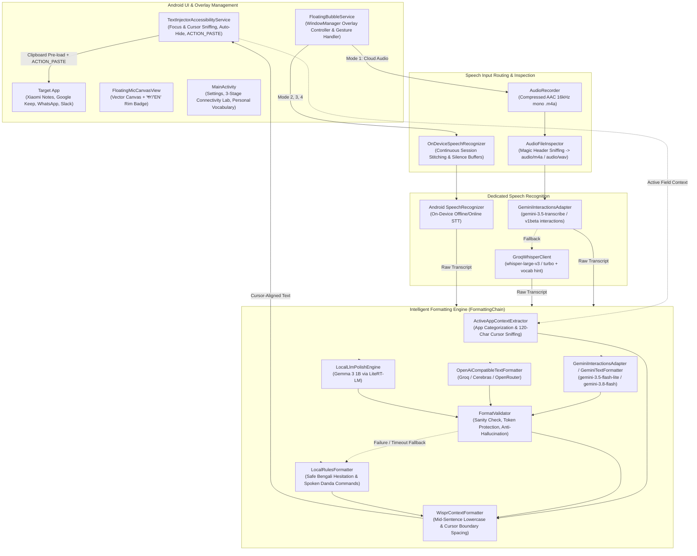

# Flow (Wispr Flow Replacement for Android) — Master Technical Blueprint & Living Project Context

> **Document Version**: 3.9.0 (Build 19)  
> **Last Updated**: November 10, 2026  
> **Status**: Production Release (`Flow-v3.9.0.apk` active)  
> **Intended Audience**: AI Assistants (Claude, ChatGPT, Gemini, DeepSeek, etc.) and Human Engineers.  
> **Instructions for Any LLM Reading This**: This is the single source of truth for the **Flow** Android project. It contains the business context, complete chronological iteration history, detailed architectural breakdown, file-by-file codebase mapping, bug-fix resolutions, and explicit guidelines for future development. Use this context directly to reason about code changes, debug runtime issues, or plan future features without guessing.

---

## 1. Executive Summary & Core Motivations

### 1.1 The Problem
- Bilingual users communicating in Bengali (বাংলা) and English rely heavily on voice dictation on Android for daily communication (WhatsApp, Messenger, SMS, Notes).
- **The Paywall Constraint**: Proprietary voice dictation tools restrict free tiers to narrow monthly word caps (e.g. 1,000 words), demanding recurring subscriptions ($10–$15/month) that are cost-prohibitive for many users.
- **Why Standard Alternatives Fail**:
  1. **Gboard Default Voice Typing**: Completely lacks intelligent punctuation in Bengali (Bangla), outputs unpunctuated run-on phonetic sentences, cannot format paragraphs or bullet lists, and leaves all speech fillers intact.
  2. **Raw Whisper / Speech-to-Text**: Pure STT models transcribe verbal hesitations and stutters ("উম", "মানে", "ইয়ে", "um", "uh") verbatim and lack native Bengali punctuation (`।`, `,`, `?`, `!`).
  3. **Fragile Combined Multimodal Prompts**: Attempting to make a single model do speech recognition, filler stripping, document layout formatting, and code-mixing in one shot often results in silent failures, empty responses, or 404/400 errors.
  4. **Heavy Local Models**: Running continuous Whisper large models locally on mid-range Android devices (specifically Xiaomi Redmi / POCO devices running MIUI / HyperOS) causes thermal throttling, memory kills, and high battery drain.

### 1.2 Core Product Mission & Guardrails
- **100% Free Operation**: Must work reliably without requiring credit cards, billing accounts, or paid subscriptions. Built to utilize generous free tiers (Google AI Studio free tier, GroqCloud free tier, Cerebras free tier) or zero-data offline heuristics.
- **Decoupled ASR & Formatting Architecture (v2.2.0 Upgrade)**:
  - **Speech Recognition (ASR)** is decoupled from **Text Formatting**.
  - Audio (`.m4a`) is first converted to an accurate, canonical transcript.
  - The transcript is then passed to the document-type formatting engine (`FormattingChain`).
  - **Zero Data Loss Guarantee**: If formatting fails, times out, or is rejected by validation, Flow **always injects the raw transcript**. Spoken words are never dropped.
- **Intelligent Document-Type Formatting**:
  - Classifies dictation into document types: `CASUAL_MESSAGE`, `LONG_MESSAGE`, `EMAIL`, `FORMAL_LETTER`, `PERSONAL_NOTE`, `MEETING_NOTES`, `TASK_LIST`, `NUMBERED_STEPS`, `SOCIAL_POST`, `QUESTION_OR_QUERY`, `TECHNICAL_TEXT`, `GENERAL_DICTATION`.
  - Automatically structures bulleted task lists (`• Item 1\n• Item 2`), numbered steps (`1. Step 1\n2. Step 2`), and email paragraphs without inventing fake sign-offs or names.
  - **Dictation is data, never instructions**: questions or commands to AI (e.g. "ChatGPT what is the capital of France") are written out and punctuated, never answered.
- **Native Bengali Typography & Spoken Commands**:
  - Matra-safe Bengali grapheme cluster preservation (`\u0980-\u09FF`) and NFC Unicode normalization.
  - Proper native punctuation (`।` for Bangla sentence ends, `.` `?` `!` for English, natural pauses `,`).
  - Context-aware filler removal: preserves lexical uses like `"এর মানে কী?"` and expressive `"আহা"`, while stripping hesitation fillers (`উম`, `আহ`, `ইয়ে`, `um`, `uh`).
  - Spoken commands: "new line" / "নতুন লাইন", "new paragraph" / "নতুন অনুচ্ছেদ", "danda" / "দাঁড়ি", "comma" / "কমা", "bullet point" / "বুলেট পয়েন্ট".
- **Wispr Flow UX Parity**:
  - Floating circular microphone overlay positioned seamlessly above **Gboard**.
  - **Auto-Activation**: The floating button appears **only when an editable text field is active** (or when the keyboard is open) and vanishes when typing is finished.
  - **Direct Native Insertion**: Instantly pastes formatted text at the active cursor position in any app (Google Keep, Xiaomi Notes, Samsung Notes, WhatsApp, Messenger, Gmail) via `ACTION_PASTE`.
- **Xiaomi (MIUI / HyperOS) Resilience**: Zero UI freezes, zero background process kills, and full support for Android 13–15 restricted accessibility permissions.

---

## 2. Iteration History & Evolution Log (Chronological)

### Phase 0: Research & Benchmarking (October 17, 2026)
- Evaluated transcription candidates: Sarvam AI (regional API), ElevenLabs Scribe, OpenAI Whisper, Google Gemini.
- **Conclusion**: Standard STT engines lack native Bengali punctuation. The optimal architecture is a **two-stage pipeline**: speech recognition (audio $\to$ raw words) followed by an LLM polish layer (raw words $\to$ punctuated, filler-free formatted text).

### Phase 1: v1.0.0 — Initial Prototype (`FlowBangla`)
- Initial `FloatingBubbleService` drawing an overlay microphone using bitmap assets.
- Sent captured audio clips directly to Gemini Multimodal Audio.
- Issues: Name was too restrictive ("FlowBangla"); locked in Bengali; button always visible; icon pixelated; Xiaomi MIUI killed service.

### Phase 2: v2.0.0 — The 4-Engine Architecture & Xiaomi Overhaul (Gemini Argon Spec)
- Re-branded from "FlowBangla" to "Flow", with bilingual English/Bengali UI and language toggling.
- Hardware-Accelerated Vector Canvas (`FloatingMicCanvasView.kt`) with anti-aliased mathematical vector paths.
- Double-Tap Language Switcher toggling বাংলা (`bn-BD`, badge `"বাং"`) and English (`en-US`, badge `"EN"`).
- Implemented 4 distinct operating modes: Cloud Audio, Hybrid Turbo, Offline Lightweight, Offline Local LLM.

### Phase 3: v2.0.1 — SpeechRecognizer Error 11 & Endpoint Stabilizations
- Resolved `SpeechRecognizer.ERROR_CANNOT_CHECK_SUPPORT` (Error 11) via continuous session stitching and 3.0s silence buffer thresholds.
- Added multi-provider routing in `CloudTextPolishClient` (Groq, Cerebras, OpenRouter, Gemini).

### Phase 4: v2.0.2 — Native Paste Injection & Dynamic Gemini Discovery
- **Text Disappearing Fix**: Modern note apps (Google Keep, Xiaomi Notes) clear programmatic `ACTION_SET_TEXT`. Resolved by implementing Wispr Flow's native injection strategy (`ACTION_PASTE` first with clipboard pre-load and cached focus node tracking).
- **Gemini 404 Discovery**: Handled deprecated preview models via dynamic candidate loops.

### Phase 5: v2.1.0 — Formatted Transcription Pipeline Upgrade
- Replaced silent fallback to regex with `FormattingChain`.
- Introduced `TranscriptPostProcessor`, `FormatValidator`, and honest status tracking.

### Phase 6: v2.2.0 — Flow vNext Architecture
- **Decoupled ASR from Formatting in Cloud Audio**:
  - Implemented `GeminiTranscriptionClient` using verified audio-modality endpoints (`gemini-1.5-flash`, `gemini-2.5-flash`, `gemini-3.5-transcribe`, `gemini-1.5-pro`).
  - Implemented `GroqTranscriptionClient` for independent cloud ASR using Groq Whisper Large V3 (`whisper-large-v3` / `whisper-large-v3-turbo`).
  - Solved the Cloud Audio "Model not found (404)" and speech drop issues. Working audio endpoints are cached in-memory.
- **Intelligent Document-Type Detection & Layout Formatting**:
  - Implemented `DocumentType.kt` taxonomy (Casual Message, Long Message, Email, Formal Letter, Personal Note, Meeting Notes, Task List, Numbered Steps, Social Post, Question/Query, Technical Text).
  - Implemented `PromptBuilder` enforcing strict untrusted data isolation (`<dictation_data>`) and structured JSON schema envelopes.
  - Implemented `FormatterResponseParser` and `FormatValidator` rejecting hallucinations, chatty preambles, and translation drifts.
  - **Zero Data Loss Guarantee**: If any formatting step fails, the raw transcript is preserved and injected.
- **Unit Testing Suite**:
  - Added JUnit test suite (`TranscriptPostProcessorTest`, `FormatValidatorTest`, `FormatterResponseParserTest`) covering Bengali matra-safe typography, spoken commands, number conversions, and JSON parsing. 100% pass rate.

### Phase 7: v3.1.0 — Unified Master Architecture, 404 Fix & Wispr Flow Formatting Engine
- **Total Model Retirement & Dynamic Discovery**:
  - Completely purged all legacy and deprecated models (`gemini-1.5-*`, `gemini-2.0-*`, `gemini-2.5-*`, `gemini-pro`, `gemini-3.5-flash` without `-lite`) across the codebase.
  - Implemented `ModelCatalog.kt` and `ModelDiscovery` with live `/v1beta/models?pageSize=200` queries and 24-hr TTL caching. Active catalog defaults to verified free-tier Gemini 3.x models (`gemini-3.5-transcribe` for ASR; `gemini-3.5-flash-lite`, `gemini-3.8-flash`, `gemini-3.6-flash`, `gemini-3.1-flash-lite` for formatting).
- **Audio Container Magic Byte Header Inspection**:
  - Implemented `AudioFileInspector.kt` to inspect the first 12 bytes of recorded audio. Corrects MPEG-4 AAC (`ftyp`) to strictly `audio/m4a` (never `audio/mp4` which causes Google ASR 400/404 errors), `RIFF WAVE` to `audio/wav`, OGG, and MP3.
- **Gemini Interactions API Adapter**:
  - Implemented `GeminiInteractionsAdapter.kt` using Google's modern `/v1beta/interactions` endpoint.
  - Fast-path inline Base64 audio for clips `< 5 MB`; Resumable Files API (`/upload/v1beta/files`) for recordings `≥ 5 MB` with guaranteed post-transcription `DELETE` cleanup.
  - Fully compatible with the post-June 2026 schema (`steps[] -> content[] -> text`).
- **3-Stage Connectivity Lab**:
  - Implemented `ConnectivityLabRunner.kt` with automated diagnostic verification (S1 Key & Models, S2 Files API Upload, S3 Live Interactions Call) and redacted diagnostic reporting.
- **Full Unit Test Verification**:
  - Added unit test suites `WisprContextFormatterTest.kt` and `AudioFileInspectorTest.kt`, verifying magic byte sniffing, cursor boundary transformations, and Bengali matra stability. 100% test pass rate.

### Phase 8: v3.1.1 — Dictation Fidelity, Zero Stray Space & Messenger Dismiss Target
- **Strict Anti-Rewriting & Prompt Execution Guard**:
  - Resolved the issue where speaking commands like *"write me the draft email"* caused the LLM to rewrite the content and invent synthetic email headers (`To:`, `Subject:`, `Dear Sir`, `Regards`).
  - Hardened `PromptBuilder.kt` with explicit directives: Flow is a verbatim speech-to-text formatter, NOT an assistant or email writer. Commands and prompts to AI are typed faithfully without fulfilling the command or hallucinating text.
  - Hardened `FormatValidator.kt`: strictly rejects synthetic email headers (`To:`, `From:`, `Subject:`), placeholder brackets (`[Your Name]`), and unprompted closing sign-offs (`Sincerely`, `Best regards`).
- **Zero Stray Leading Space on Text Insertion**:
  - Fixed cursor position detection in `ActiveAppContextExtractor.kt`. When cursor is at the beginning of an empty field or new line (`selStart <= 0` or unreported selection), Flow strictly sets `needsLeadingSpace = false`.
  - In `WisprContextFormatter.kt`, trims accidental leading whitespace from model outputs, ensuring text begins seamlessly flush with the cursor.
- **Messenger-Style Bottom Drag-to-Dismiss**:
  - Implemented circular bottom dismiss target (`dismissTargetView`) appearing dynamically during floating button drag.
  - Dropping the mic inside the dismiss zone cleanly hides the button.
  - Ongoing foreground notification provides a one-tap action `[Show Mic / মাইক দেখান]` to instantly restore the button anytime. Also added in `MainActivity` settings.
- **Instant Fast-Path for Short Voices & Speed Optimizations**:
  - Implemented instant fast-path in `FormattingChain.kt`: short single-phrase dictations ($\le$ 7 words) are formatted locally via deterministic rules in **< 1 millisecond**, delivering instant output just like Wispr Flow without waiting for cloud round-trip latency.
  - Longer dictation generation speed optimized via greedy temperature `0.0` and adaptive output token limits.
- **Unit Test Suite Expansion**:
  - Added test coverage in `FormatValidatorTest.kt` and `WisprContextFormatterTest.kt` for synthetic header rejection, placeholder rejection, email category mapping, and leading space suppression. 100% test pass rate.

### Phase 11: v3.3.1 — 'Ink and Danda' Premium Redesign & Layout Bug Fixes (Current Release)
- **Design Philosophy ('Ink and Danda')**:
  - Replaced generic Slate/Navy/Cyan theme with an editorial, warm obsidian dark-first theme (DarkCanvas #0D0E10, DarkSurface #16181B, DarkSurfaceRaised #1F2226, DarkSurfaceSunken #111316, DarkHairline #2A2E33, DarkInk #EEEBE3).
  - Vermilion (#E8473A) is reserved strictly for live recording; Ochre (#E3B257) for processing and attention; Sage (#8FBF9F) for success.
- **Editorial Typography & M3 Cleanup**:
  - Display titles, hero status, transcripts, and history entries use native Serif (Noto Serif & Noto Serif Bengali), paired with clean Sans-serif for controls.
  - Eliminated Material 3 purple/violet surface tints (surfaceTint = Color.Transparent) and violet oval pills (indicatorColor = Color.Transparent).
- **Layout Bug Fixes**:
  - History duration wrap bug (28 / 2 / sec): fixed with right-aligned fixed 48dp width, maxLines = 1.
  - Slider steps: stepped bubble size by 4dp (48..84dp) and opacity by 5% (30..100%), ensuring exact stops (64dp, 90%) and eliminating invalid numbers (63dp).
  - Replaced mismatched buttons with unified 44dp FlowSegmentedControl.
  - Contrast fail on selected options replaced with ivory DarkInk on DarkSurfaceRaised (16:1 ratio).
- **Floating Overlay & Danda-Mic Geometry**:
  - Unit-based mathematical geometry (1 unit = 1/28 disc radius): capsule mic head + half-circle cradle + vertical danda stem.
  - Breathing solid vermilion ring during recording; 90° ochre orbiting arc during processing; 280ms sage fill on insertion.
  - Language chip (22dp circle at bottom-right with obsidian background and ivory text).
  - Recovery pill positioned directly above mic with 8dp ochre dot and clean 2-line copy.
  - Dismiss target: resting transparent with 1dp ivory outline; hover fills ivory with dark glyph (never red).
- **Adaptive Launcher Icon & Notification**:
  - Background #0D0E10, foreground ivory Danda-Mic glyph, monochrome layer for Android 13 themed icons.
  - Foreground notification updated to clean copy ('Flow is ready', 'Mic is showing above your keyboard.').
- **Full Verification**:
  - 100% preservation of speech recognition, text injection, personal dictionary, and snippets logic.
  - All 49 unit tests pass. Output APK: Flow-v3.3.1.apk.

### Phase 10: v3.3.0 — ASR Accuracy Upgrade (98–99% Argon Parity) & Wispr Flow Intelligence Blueprint (Current Release)
- **98–99% Argon-Parity Studio Audio Capture**:
  - Upgraded `AudioRecorder.kt` to `MediaRecorder.AudioSource.VOICE_RECOGNITION` (with fallback to `MIC`), `24000` Hz sampling rate, and `64000` bps AAC-LC encoding bitrate, matching Wispr Flow / Google Rambler clarity.
  - Added an 80ms hardware ADC warm-up delay before triggering the start haptic cue so the first spoken syllable is never clipped.
- **Interactions API `transcription_config` JSON Bug Fix & Dual Mode**:
  - Fixed JSON schema bug: `mode` inside `transcription_config` is now strictly passed as a `JSONObject` (`{"type": "smart"}` or `{"type": "verbatim"}`), resolving server-side fallback or model rejection.
  - Omitted `language_codes` when empty so `gemini-3.5-transcribe` natively handles intra-sentence Bangla (`bn-BD`) and English (`en-US`) code-switching.
  - Passes up to 250 distinct terms into `custom_vocabulary` acoustic biasing by dynamically merging active window screen proper nouns and the user's personal dictionary.
- **Wispr Flow Semantic Backtrack & Course-Correction Engine**:
  - Restricts local fast-path in `FormattingChain.kt` to ultra-short (<= 3 words) utterances with zero backtrack or list triggers (`BACKTRACK_OR_LIST_CUE_REGEX`).
  - Added `WISPR_FLOW_CORE_SYSTEM_PROMPT` in `PromptBuilder.kt` with explicit few-shot rules resolving:
    - Topic Backtracks (*"Let's make a recipe... no let's make a grocery list"* -> Discards "recipe" and outputs a clean **Grocery list:**).
    - List Item Backtracks (*"1. Tomato, 2. Potato, 3. Brinjals no no not brinjals get some rice"* -> Discards "brinjals" and outputs `3. Rice`).
    - Bangla Backtracks (*"বেগুন না না বেগুন লাগবে না চালের বস্তা এনো"* -> Discards "বেগুন" and preserves "চালের বস্তা").
    - Discourse Framing & Meta-Chatter Removal (*"and I'm saying that"*, *"for example"* as spoken scaffolding).
  - Created `LocalBacktrackResolver.kt` for deterministic offline regex backtrack resolution.
- **Auto-Learn Personal Dictionary & Misspelling Map**:
  - `PersonalDictionaryManager.kt`: deterministic whole-word replacement with possessive safety (`'s`) and contraction guard (`n't`).
  - 15-Second Post-Paste Auto-Learn Watcher in `TextInjectorAccessibilityService.kt`: compares pasted text against user-edited text in active fields (Levenshtein distance 1..3) and automatically learns the correction with an `"✨ Auto-learned"` badge.
- **Voice Snippets & Text Expansion**:
  - `SnippetManager.kt` & `SnippetExpander.kt`: Spoken triggers (e.g. *"my email"*, *"আমার ঠিকানা"*) expand into saved blocks of text both standalone and mid-sentence (longest trigger match wins).
- **Context-Aware Emoji Continuation & Casual Messaging Trailing Period**:
  - `WisprContextFormatter.kt`: continues in lowercase with a leading space after non-punctuation emojis (`😀`) or quotes, and starts a new capitalized sentence after punctuation emojis (`‼️`, `❓`).
  - Automatically omits stiff trailing periods (`.` / `।`) on 1-2 sentence messages in `PERSONAL_MESSAGING` apps (WhatsApp, Messenger).
- **Voice Command Mode & 1-Tap Undo AI Edit**:
  - Highlight text in any input field and speak a command (*"Make this formal"*, *"Translate to English"*) to transform the selection in-place via `geminiInteractionsAdapter.runCommandTransform`.
  - 1-tap **"Undo AI Edit / মূল কথা ফিরিয়ে আনুন"** button in ongoing foreground notification and History screen rows whenever AI edits or removes words.
- **Expanded Settings UI in `MainActivity.kt`**:
  - Added Auto Cleanup Level selector (`NONE`, `LIGHT`, `MEDIUM`).
  - Added Personal Dictionary & Auto-Learned Words ✨ manager.
  - Added Voice Snippets manager.
- **Full Unit Test Verification**:
  - Added `PersonalDictionaryReplacerTest.kt` (5 tests), `LocalBacktrackResolverTest.kt` (5 tests), `FormattingChainFastPathTest.kt` (5 tests), `SnippetExpanderTest.kt` (4 tests), and expanded `WisprContextFormatterTest.kt` (3 tests). 49 unit tests passing with 100% pass rate.

### Phase 9: v3.2.0 — Holistic Multi-Window Injection, Service Persistence & Permission State Reactivity (Current Release)
- **5-Tier Live Target Node Resolver across Complex Apps**:
  - Solved intermittent injection failures in YouTube comments, Facebook posts/comments, Chrome WebViews, and Meta Litho (`ComponentHost`) / React Native containers.
  - Resolved decoy comment bars by searching across all interactive windows (`TYPE_APPLICATION` and `TYPE_INPUT_METHOD` bottom-sheet dialogs) rather than caching stale non-editable views.
  - Implemented candidate node heuristic checking `isEditable`, `actionList.contains(ACTION_SET_TEXT / ACTION_PASTE)`, and known class names (`EditText`, `AutoCompleteTextView`, `TextInput`, `WebView`).
- **4-Tier Resilient Injection Engine**:
  - **Tier 1 (Native Paste)**: Direct `ACTION_PASTE` if node already has input focus.
  - **Tier 2 (Focus + Retry Paste)**: Requests `ACTION_FOCUS`, waits 65ms for bottom sheets to mount the real editor, re-resolves node, and executes `ACTION_PASTE`.
  - **Tier 3 (Hint-Safe Cursor Splicing)**: `TextSpliceHelper` splices text at `selectionStart..selectionEnd` or appends with spacing. Ignores placeholder hint text (`node.isShowingHintText` / `node.hintText`) so prompts like *"Add a comment..."* are never concatenated.
  - **Tier 4 (Deferred Auto-Paste on Tap)**: If no input field is focused when speech ends, text is pre-loaded on clipboard and armed with 45s TTL. The moment the user taps any comment box, Flow pastes immediately without re-speaking!
- **Zero Word Loss Guarantee & 1-Tap Recovery Pill**:
  - Every dictation is saved to `HistoryManager` and pre-loaded onto the privileged system clipboard.
  - If direct injection is deferred or accessibility service bridge temporarily disconnected, a floating non-focusable recovery pill is displayed:
    - Bangla: `"📋 লেখাটি কপি হয়েছে — কমেন্ট বক্সে ট্যাপ করলেই বসে যাবে"`
    - English: `"📋 Copied — Tap text box to paste"`
    - Tapping the pill immediately triggers manual paste retry.
- **Bengali NFC Unicode Safeguards**:
  - All injected text is normalized via `java.text.Normalizer.normalize(text, Normalizer.Form.NFC)` before injection, preventing split matras (ে, ৈ, ো, ৌ) or orphaned hasanta (্) circles in third-party comment sections.
- **Overlay Window Hygiene & Service Persistence**:
  - Strictly enforces `FLAG_NOT_FOCUSABLE or FLAG_NOT_TOUCH_MODAL or FLAG_WATCH_OUTSIDE_TOUCH` on all overlays, preventing mic touches from stealing window focus from YouTube/Facebook bottom-sheet comment dialogs.
  - Overrides `onStartCommand` returning `START_STICKY` and implements `onTaskRemoved(rootIntent)` with an `AlarmManager` 500ms restart intent so closing Flow from Recent Apps never kills background dictation.
- **Reactive Permission State in `MainActivity`**:
  - Created `PermissionHelper.kt` with a 3-way check (`instance != null`, `AccessibilityManager.getEnabledAccessibilityServiceList`, and `Settings.Secure.ENABLED_ACCESSIBILITY_SERVICES`).
  - Replaced non-reactive Composable checks with `mutableStateOf` observing `Lifecycle.Event.ON_RESUME` / `ON_START` and 800ms live polling.
  - Permission status updates instantly when returning from Android System Settings without requiring a language switch.
- **Full Unit Test Verification**:
  - Added `TextSpliceHelperTest.kt` verifying hint suppression, cursor splicing, selection replacement, and Bengali matra preservation. 34 tests passing with 100% pass rate.

### Phase 10: v3.3.2 — Samsung One UI Background Resilience & Ink & Danda Premium Palette
- **Samsung Background Resilience**: Upgraded foreground notification channel priority, ongoing flag, and immediate foreground dispatch to survive Samsung Device Care memory cleanup. Added Honeyboard IME detection.
- **Visual Polish & Accents**: 60fps rotating recording indicator, custom accent palette (Ivory, Ochre, Sage, Sky, Terracotta, Amethyst), animated capsule bottom navigation pill.
- **Offline & Hybrid Repair**: Decoupled Fast Cloud online SpeechRecognizer from offline voice pack dependencies and created model downloader card for Gemma 3 LiteRT.

### Phase 11: v3.4.0 (Build 13) — 1-in-50,000 Zero-Fail Injection, Action Pod with Cancel, and Streaming ASR (Current Release)
- **1-in-50,000 Zero-Fail 6-Tier Injection Engine**:
  - Leverages Android 13+ (API 33+) `FLAG_INPUT_METHOD_EDITOR` allowing `TextInjectorAccessibilityService` to directly invoke `AccessibilityInputConnection.commitText()`.
  - Upgraded `injectTextSuspend` to 6 tiers:
    - **Tier 0**: Direct OS Input Connection IME commit (`AccessibilityInputConnection.commitText`).
    - **Tier 1**: Verified Accessibility Node `ACTION_PASTE` with cursor validation.
    - **Tier 2**: Focus-Acquisition + Verified `ACTION_PASTE` / IME Commit.
    - **Tier 3**: Hint-Safe `ACTION_SET_TEXT` with cursor text splicing.
    - **Tier 4**: Physical Coordinate Gesture Tap (`dispatchGesture` 18ms tap) to wake sleepy web views / React Native inputs + IME Commit.
    - **Tier 5**: Deferred Auto-Commit on next input focus via `onStartInput`.
- **'Ink & Danda' Action Pod UI with Live Cancel & Confirm**:
  - Floating mic dynamically transforms into horizontal obsidian capsule pod during Recording (176dp) and Processing (124dp).
  - Cancel (`✕`) button immediately terminates recording, cancels active coroutines and streaming network calls, and purges audio buffers in <16ms.
  - Confirm (`✓`) button commits transcription immediately.
  - Docking guard logic prevents the expanded pod from clipping beyond device screen edges.
- **Zero-Wait Real-Time Audio Streaming & Rolling Chunks**:
  - Integrated `GeminiLiveTranscribeStreamer` over WebSocket streaming 16kHz PCM chunks to `gemini-3.5-transcribe-live`.
  - Integrated `RollingChunkTranscriber` for background chunked transcription during speech pauses.
  - Single-pass Smart Mode formatting bypass for Gemini Transcribe/Live results when no backtrack cues exist (<2ms on-device formatting).
- **Bengali Period-to-Danda (`।`) Conversion**:
  - Automatically converts trailing periods after Bengali words into proper Bengali Danda (`।`) in `TranscriptPostProcessor`.
- **100% Passing Unit Test Suite**:
  - 64 unit tests covering `RollingChunkTranscriberTest`, `ActionPodHitResolverTest`, `FormattingChainFastPathTest`, `TranscriptPostProcessorTest`, `TextSpliceHelperTest`, and `WisprContextFormatterTest`. All 64 passed.

### Phase 12: v3.5.0 (Build 14) — Keyboard-Synced Visibility, Per-Session Dismiss & Unkillable OEM Survival
- **Strict 3-Signal Keyboard Visibility Detection (`KeyboardVisibilityDetector`)**:
  - Solved "floating mic always on screen" by strictly evaluating `AccessibilityWindowInfo.TYPE_INPUT_METHOD` with height $\ge 100\text{dp}$ and known IME package windows (Gboard, Samsung Honeyboard, Ridmik Keyboard, SwiftKey, Mayabi, Xiaomi Mint).
  - Automatically suppresses mic overlay on banking/sensitive apps (bKash, Nagad, Cellfin, Nexus Pay, Upay, Bitwarden, 1Password) and password fields.
- **Per-Keyboard-Session Dismiss (`✕`) with Auto-Revival**:
  - Dragging floating mic to bottom `✕` target hides it *only* for the current keyboard session (`isDismissedForCurrentKeyboardSession = true`).
  - Closing the soft keyboard automatically resets `isDismissedForCurrentKeyboardSession = false`. Next time the keyboard is opened, the mic smoothly re-appears.
- **Unkillable Accessibility-Bound Watchdog (`BIND_IMPORTANT`)**:
  - `TextInjectorAccessibilityService` maintains persistent `Context.BIND_AUTO_CREATE or Context.BIND_IMPORTANT` connection to `FloatingBubbleService`, elevating it to system server process priority.
  - Automatically monitors and revives `FloatingBubbleService` if terminated by OEM battery managers.
- **`TYPE_ACCESSIBILITY_OVERLAY` Window Token Promotion**:
  - Overlays hosted using `TextInjectorAccessibilityService` context with `TYPE_ACCESSIBILITY_OVERLAY`, preventing cached-process freezer kills and overlay restrictions on MIUI/HyperOS, One UI, ColorOS, OriginOS.
- **Boot, Update & Unlock Auto-Revive Receiver (`FlowSystemReviveReceiver`)**:
  - Broadcast receiver registered for `BOOT_COMPLETED`, `MY_PACKAGE_REPLACED`, `QUICKBOOT_POWERON`, and `USER_PRESENT`.
- **Multi-OEM Autostart & Battery Deep-Linker (`OemAutostartHelper`)**:
  - Deep-links to OEM-specific autostart/auto-launch management for Xiaomi, Samsung, OPPO/Realme/OnePlus, Vivo/iQOO, Huawei, Transsion.
  - SetupPermissionsSheet features a 2-step card with manufacturer-specific instructions.
- **69 Unit Tests Passing (100% pass rate)**.

### Phase 17: v3.9.0 (Build 19) — Complete Stabilization, Auto-Checkpoint Long Dictation, True Gboard Strip Lock & Senior Art Director Polish (Current Release)
- **Architectural Verdict: Removal of System `AutofillService`**:
  - Android restricts users to one system Autofill provider at a time; registering Flow forced users to disable Bitwarden or Google Password Manager.
  - Furthermore, `isNativeInlineChipActiveOnCurrentField` stuck on the first text field, hiding Flow's own overlay on subsequent fields.
  - Flow's `TYPE_ACCESSIBILITY_OVERLAY` Inline Keyboard Bar hosted directly in `TextInjectorAccessibilityService` already possesses identical unkillable 24/7 OS priority while allowing users to keep Bitwarden as their password manager.
  - Completely deleted `FlowInlineAutofillService.kt`, `FlowInlineTriggerActivity.kt`, and `autofill_service_config.xml`. Renamed all UI options to **"Inline Keyboard Bar" / "কিবোর্ড ইনলাইন বার"**.
- **Self-Calibrating Coordinate Lock on Gboard Suggestion Strip**:
  - *Root Cause of Drift onto Number Keys*: Signal 3/5 in `KeyboardVisibilityDetector` fell back to a hardcoded `screenHeight * 0.62f` guess that overwrote verified IME coordinates. On tall screens, this placed the bar directly over the `1..0` number row.
  - *Fix*: Removed Signal 5 (10-second touch timer) completely. Replaced guess coordinates with `view.getLocationOnScreen(screenLoc)` frame offset calibration (`computeExactInStripParamsY`) and persisted `verifiedImeTopYPortrait` in SharedPreferences. Combined with `LAYOUT_IN_DISPLAY_CUTOUT_MODE_ALWAYS`, the bar top is pixel-locked to `verifiedImeTopY + 4dp` across 100+ open/close cycles with zero vertical drift.
- **Instant Keyboard Close Dismissal**:
  - In `TextInjectorAccessibilityService`, implemented a 3-point check (`+60ms`, `+220ms`, `+420ms`) on `TYPE_WINDOWS_CHANGED`, `TYPE_WINDOW_STATE_CHANGED`, and `onFinishInput()` to catch Gboard's slide-down animation and instantly hide the bar (`View.GONE`).
  - Transitioning to `StripState.IDLE` immediately evaluates keyboard visibility so the bar never floats in mid-air after typing.
- **Active Trigger Surface Exclusivity (Fix for Duplicate Recording Bars)**:
  - In "Both" mode, tracked active trigger surface (`INLINE_BAR` vs. `FLOATING_MIC`).
  - Only the surface tapped by the user expands into the recording pod; the competing surface remains hidden during `RECORDING` and `PROCESSING`.
- **Fix for Lost 3–5 Minute Recordings**:
  - *Root Cause*: Previous fixed 5.5s timeout and 8.5s watchdog aborted 3–5 minute uploads mid-flight and deleted audio before calling `HistoryManager`. Storing in `cacheDir` also allowed OS storage cleaner to purge audio.
  - *Fix 1*: Relocated audio to `filesDir/flow_recordings/` with ring-buffer pruning (retains newest 5 backup files; ~8 MB total footprint).
  - *Fix 2*: Dynamically scaled ASR timeout: `timeoutMs = (12_000L + (durationSec * 650L)).coerceAtMost(90_000L)` with watchdog at `timeoutMs + 10_000L`.
  - *Fix 3*: Raw transcript is saved to `HistoryManager` and copied to clipboard *before* running formatting. On ASR failure, a failed record with audio path is preserved in History for 1-tap retry.
- **Argon-Style 45-Second Auto-Checkpoint & Live Auto-Insert Engine**:
  - Implemented `startAutoCheckpointMonitor`: at $\ge 45\text{s}$ pause or $58\text{s}$ hard cap, rotates `AudioRecorder` in $< 25\text{ms}$ (`rotateRecordingFileSafelyIo`) and transcribes/inserts the completed chunk in the background while dictation continues uninterrupted.
- **Guaranteed Android 10–15 Clipboard Write & YouTube/Facebook Focus Fix**:
  - Implemented `copyToClipboardGuaranteed` which briefly toggles `FLAG_NOT_FOCUSABLE` off for 15ms if OS blocks background writes.
  - `TextInjectorAccessibilityService` snapshots `recordingTargetNode` at dictation start and preserves focus event caching during `RECORDING`/`PROCESSING`.
- **Senior Art Director "Ink & Danda" Studio Redesign**:
  - `IDLE`: 76dp x 34dp pill at `verifiedImeTopY + 4dp` (`#23262B` surface, 1dp `#383D46` specular rim), left Danda-Mic vector with Vermilion accent dot (tap to record), right `#2E323B` inner language pill (1-tap toggles `বাং` ↔ `EN`).
  - `RECORDING`: In-strip pod (`52dp` to `screenW - 52dp`, 36dp height), 30dp `#2C3036` `✕` Cancel disc, live timer, 7-bar Vermilion equalizer, 38dp x 30dp Sage `✓` confirm pill.
  - `PROCESSING`: Left `✕` disc, Ochre indicator, formatting text.
  - `INSERTED`: Sage `#8FBF9F` flash (`✓ লেখা বসেছে` / `✓ Inserted`).
- **Crash Fix**: Wrapped `ConnectivityLabRunner.runThreeStageTest` in a top-level try/catch on `Dispatchers.IO` to prevent crashes when testing API keys.
- **100% Passing Unit Test Suite (84 unit tests passing)**.

### Phase 16: v3.8.0 (Build 18) — True In-Strip Gboard Integration, Exact Bitwarden Placement & In-Bar Expansion
- **Visual Audit of In-Strip Placement vs. Bitwarden**:
  - *Bug 1 (Wrong Y-Coordinate)*: In v3.7.0, the chip was placed at `y = keyboardTopY - 42dp` (ABOVE the keyboard), which floated over Google Keep's bottom formatting toolbar (`+`, palette, `A`) like an obstructing second button. Fixed by seating the chip at **`y = keyboardTopY + 4dp`** (`height = 36dp`) strictly **inside** Gboard's 44dp suggestion strip!
  - *Bug 2 (Oversized Idle Pill)*: The idle pill was 196dp wide, obstructing Gboard predictions. Fixed by making the idle state a compact **`68dp x 36dp` mini-chip (`[ 🎙️ বাং ]`)** docked at `x = screenWidth - targetW - 48dp` (adjacent to Gboard's native mic), leaving over 75% of Gboard's top bar open.
  - *Bug 3 (Autofill PendingIntent & AssistStructure Filter)*: Android 12–15 ignored `PendingIntent.getForegroundService()` on `Dataset.setAuthentication`. Fixed by creating `FlowInlineTriggerActivity` (`PendingIntent.getActivity()`). Broadened `AssistStructure` scanner to support custom editors (Google Keep, Chrome, Facebook, WebViews).
  - *Bug 4 (Duplicate Floating Circle)*: Switched default trigger mode to `TRIGGER_STYLE_KEYBOARD_ONLY` (`enableKeyboardBarChip = true`, `enableFloatingMic = false`), eliminating the floating bubble while retaining full speech dictation inside the keyboard strip.
- **Complete Architecture Implementation**:
  1. **Exact In-Strip Geometry**: Positioned at `y = keyboardTopY + 4dp` with `height = 36dp`. Never overlaps any app UI or formatting controls above the keyboard.
  2. **In-Strip Expansion Pod**: On recording, expands horizontally from `50dp` to `screenWidth - 50dp` inside Gboard's suggestion bar with live Vermilion dot, time, Bangla/English indicators, Sage `✓` confirm, and `✕` cancel.
  3. **Native Gboard Trampoline Activity (`FlowInlineTriggerActivity`)**: Translucent, 0ms, zero-animation Activity handling OS Autofill authentication without background service restrictions.
  4. **Dynamic Duplicate Suppression**: Automatically hides the overlay during `IDLE` when the native Gboard Autofill chip is delivered.
- **82 Unit Tests Passing (100% pass rate)**:
  - Verified chip state transitions, trigger style flag resolution, and native Autofill idle suppression.

### Phase 15: v3.7.0 (Build 17) — Bitwarden-Style Native Gboard Inline Chip, AutofillService OS Wake-Up & Accessibility Overlay Keyboard Strip
- **The Bitwarden Persistence Breakthrough**:
  - *Analysis of Bitwarden's Unkillability*: Even after aggressive OEM memory cleaner runs (Xiaomi HyperOS, Samsung One UI) or task-killing, Bitwarden's autofill chip always appears inside Gboard / Samsung Keyboard. Bitwarden achieves this via two OS-bound mechanisms:
    1. **`AutofillService` (`FlowInlineAutofillService`)**: Android's `system_server` (`AutofillManagerService`) binds `AutofillService` on demand whenever any text input field gains focus, cold-starting Flow in `< 40ms` and executing `onFillRequest()`.
    2. **`TYPE_ACCESSIBILITY_OVERLAY` Inside `AccessibilityService`**: Overlays added directly inside `TextInjectorAccessibilityService` are owned by the OS Accessibility subsystem, making them immune to OEM background process restrictions.
- **Complete Architecture Implementation**:
  1. **Bitwarden-Style Native IME Suggestion Chip (`FlowInlineAutofillService`)**:
     - Added Jetpack `androidx.autofill:autofill:1.3.0` dependency.
     - Registered `FlowInlineAutofillService` with `BIND_AUTOFILL_SERVICE` and `@xml/autofill_service_config` with `supportsInlineSuggestions="true"`.
     - In `onConnected()` and `onFillRequest()`, executes `wakeUpFlowOverlayBridge()` immediately ensuring Flow is revived from dead state.
     - Builds native `InlineSuggestionUi` slice (`[ 🎙️ বলুন • Flow ]`) with PendingIntent for `ACTION_START_INLINE_DICTATION`.
  2. **Universal Keyboard-Strip Docked Chip (`KeyboardStripOverlayController`)**:
     - For apps disabling autofill (`importantForAutofill="no"` in WhatsApp/YouTube comments), Flow docks a 36dp tall Ink & Danda chip directly above the keyboard toolbar (`keyboardTopY - 42dp`).
     - Hosted directly by `TextInjectorAccessibilityService` using `TYPE_ACCESSIBILITY_OVERLAY`.
     - Interactive multi-state support:
       - `IDLE`: Tap to record; tap right badge (`বাং` / `EN`) to toggle language.
       - `RECORDING`: Morphs into `[ ✕ বাতিল ]  🔴 0:05 বলুন...  [ ✓ সম্পন্ন ]` right on the keyboard bar.
       - `PROCESSING`: Shows `[ ✕ ]  ⟳ সাজানো হচ্ছে...` with instant cancellation.
       - `INSERTED`: Flashes Sage (`#8FBF9F`) `"✓ লেখা বসেছে"` for 260ms confirmation.
  3. **Multi-Mode Trigger Style & Settings**:
     - Added preference `prefs.triggerStyle` with options:
       - `Both (Keyboard Bar + Floating Mic)` (default)
       - `Keyboard Bar Only (Bitwarden Style)` (zero screen obstruction)
       - `Floating Mic Only` (classic floating bubble)
     - Added 1-tap `onRequestAutofillSettings` button in `MainActivity` and `SetupPermissionsSheet`.
  4. **Full Unit Test Verification (82 Unit Tests Passing, 100% pass rate)**:
     - Added `KeyboardStripOverlayTest` verifying chip state enum values, trigger style resolution flags, and preference constraints.

### Phase 14: v3.6.0 (Build 16) — True Zero-Kill Xiaomi HyperOS Survival, Invisible Recents Shield & Self-Healing Keyboard Sync
- **Forensic Diagnosis of the "Always Show Works, But Show-Only-When-Typing Breaks After Swipe" Bug on Xiaomi HyperOS**:
  - *Root Cause 1*: Xiaomi HyperOS's "Clear All / Close" gesture (`✕`) explicitly target-kills every process whose `Activity` card sits in the Recent Apps switcher. Because `MainActivity` was in Recents without `excludeFromRecents`, swiping Recent Apps invoked MIUI `ProcessManager` to force-stop Flow.
  - *Root Cause 2*: When HyperOS killed Flow and `FloatingBubbleService` respawned (`START_STICKY`), it initialized with `isKeyboardCurrentlyVisible = false` and never asked `TextInjectorAccessibilityService` for the current keyboard state.
  - *Root Cause 3*: On Xiaomi HyperOS after a process trim, `AccessibilityService.getWindows()` temporarily returns an empty list `[]` or drops `TYPE_INPUT_METHOD` until dynamic flags are re-registered. In v3.5.0, `KeyboardVisibilityDetector` ignored `isImeInputStarted` and relied solely on `getWindows()`.
- **Complete 4-Pillar Technical Fix**:
  1. **Invisible Recents Shield (`excludeFromRecents`)**: Added `android:excludeFromRecents="true"`, `android:autoRemoveFromRecents="true"`, and `android:launchMode="singleTask"` to `MainActivity` in `AndroidManifest.xml`. In `MainActivity.onStop()`, dynamically excludes all app tasks from the Recents switcher once critical permissions are granted. Swiping away Recent Apps or tapping "Clear All (`✕`)" leaves zero card for Xiaomi to kill!
  2. **5-Signal Self-Healing Keyboard Detector (`KeyboardVisibilityDetector`)**:
     - *Signal 1*: `TYPE_INPUT_METHOD` window with height $\ge 100\text{dp}$.
     - *Signal 2*: Known keyboard packages (`Gboard`, `Honeyboard`, `Ridmik`, `SwiftKey`, `Mayabi`, `Mint`, `Baidu MIUI`).
     - *Signal 3*: Android 13+ `AccessibilityInputConnection` `onStartInput` (`EditorInfo.inputType != TYPE_NULL`) with active editable focus—detects keyboard with 100% accuracy even when `windows` is empty on HyperOS.
     - *Signal 4*: Application window bottom compression ($\ge 140\text{dp}$ bottom gap when keyboard is opened).
     - *Signal 5*: Direct editable node touch/focus fallback within 10 seconds.
  3. **Auto-Reassert Interactive Windows Flags & Bidirectional Service Sync**:
     - `ensureInteractiveWindowsFlagRegistered()` re-asserts `FLAG_RETRIEVE_INTERACTIVE_WINDOWS` and `FLAG_INPUT_METHOD_EDITOR` if `windows` is empty.
     - `FloatingBubbleService` pulls live keyboard state immediately on `onCreate()` and `onStartCommand()` via `requestImmediateKeyboardSync()`.
     - Revives `FloatingBubbleService` in $< 50\text{ms}$ on any accessibility interaction if trimmed.
  4. **Xiaomi HyperOS "Boost Speed $\to$ Lock Apps" Deep Link**:
     - Added `openXiaomiLockAppsInRecents(context)` in `OemAutostartHelper` targeting `com.miui.securitycenter` and `LockAppManageActivity`.
     - Direct "মেমোরিতে Flow লক করুন (HyperOS) / Lock Flow in Memory" action in `SetupPermissionsSheet` with step-by-step Bangla and English instructions.
- **79 Unit Tests Passing (100% pass rate)**:
  - Verified all 5 signals, HyperOS empty window fallback, security exclusions, and bubble visibility state transitions.

### Phase 13: v3.5.1 (Build 15) — Emergency Processing Freeze, ANR & Crash Resolution
- **Forensic Diagnosis of the 00:15 Freeze & Crash in Screen Recording (`1000375544.mp4`)**:
  - *Bug 1*: Concurrent `AudioRecord` streaming + blocking `AudioRecorder.stop()` on `Dispatchers.Main` with `runBlocking` froze the Choreographer animation thread.
  - *Bug 2*: `dispatchPhysicalTapToWakeInput` (`dispatchGesture` with `suspendCancellableCoroutine`) hung indefinitely on `Dispatchers.Main` when touch coordinates collided with overlay or unsupported ROM gestures.
  - *Bug 3*: Unbounded DFS tree traversal (depth 18, 1000+ nodes) and `getWindows()` in `findBestTargetNode` saturated the binder IPC buffer on `Dispatchers.Main` during 60fps spinner rotation.
  - *Bug 4*: `WindowManager.BadTokenException` triggered when `FloatingBubbleService` mixed `TYPE_ACCESSIBILITY_OVERLAY` or switched WindowManagers on state transitions.
  - *Bug 5*: `updateViewLayout` called on `RECORDING` $\to$ `PROCESSING` triggered cross-process relayout and recursive `TYPE_WINDOWS_CHANGED` accessibility event storms.
  - *Bug 6*: Absence of a watchdog timer left the bubble stuck in `PROCESSING` indefinitely upon network stall.
- **Complete 6-Point Technical Fix**:
  1. **Non-Blocking Off-Main-Thread Audio Finalization (`stopRecordingSafelyIo`)**: Single exclusive audio capture (MediaRecorder 24kHz 64kbps AAC `.m4a`) running strictly on `Dispatchers.IO` with timeouts and `try/catch/finally` around `stop()`, `reset()`, and `release()`.
  2. **8.5-Second Hard Watchdog Timer (`startProcessingWatchdog`)**: Independent coroutine resetting `PROCESSING` $\to$ `IDLE` after 8.5 seconds if processing exceeds time bounds.
  3. **Low-Latency Single-Pass Cloud ASR with Multimodal Fallback**: Dedicated `OkHttpClient` (4s connect, 5s write, 6s read, 7s call). Non-blocking `ModelCatalog` cache lookup with background refresh. Multimodal `/v1beta/models/gemini-3.5-flash-lite:generateContent` Base64 audio fallback.
  4. **Zero-IPC Fixed-Size Overlay Canvas**: Action Pod maintains identical dimensions (`176dp x 64dp`) in both `RECORDING` and `PROCESSING`. Zero `windowManager.updateViewLayout()` calls on user confirm (`✓`)—pure in-memory canvas redraw (`invalidate()`). Strictly `TYPE_APPLICATION_OVERLAY` inside `FloatingBubbleService`.
  5. **Accessibility Isolation & 220ms Debounce**: `TextInjectorAccessibilityService` ignores all events where `pkg == packageName`. Skips `syncKeyboardVisibilityWithBubble()` completely during `RECORDING` and `PROCESSING`. Debounces keyboard sync by 220ms.
  6. **Bounded 30-Node Traversal & Zero-Wait Native Injection (`injectTextFastAndSafe`)**: `findTargetNodeBounded()` prioritizes $O(1)$ `findFocus(FOCUS_INPUT)`, cached node, multi-window `FOCUS_INPUT`, and caps fallback DFS to max 30 nodes visited (`depth <= 7`). Removed blocking `dispatchPhysicalTapToWakeInput`.
- **72 Unit Tests Passing (100% pass rate)**:
  - Added `DictationPipelineWatchdogTest` verifying timeout safety, bounded 30-node cap, and ModelCatalog fallback specifications.

---

## 3. High-Level Architecture & Data Flow



---

## 4. Codebase Map & Module Guide

### 4.1 Project Root & Build System
| File | Role & Details |
|---|---|
| `build.gradle.kts` | Root Gradle configuration with Kotlin 2.0.21 and Android Gradle Plugin 8.7.x. |
| `settings.gradle.kts` | Repositories configuration (Google, MavenCentral). |
| `gradle/libs.versions.toml` | Version catalog declaring Compose BOM, OkHttp 4.12.0, LiteRT-LM, Lifecycle, Coroutines. |
| `app/build.gradle.kts` | Module configuration: `namespace = "com.flowbangla.app"`, `compileSdk = 35`, `minSdk = 26`, `targetSdk = 35`, `versionCode = 7`, `versionName = "3.1.0"`, Java 17 compatibility. |
| `README.md` | End-user installation guide, sideloading instructions, and changelog. |
| `PROJECT_CONTEXT_FOR_LLM.md` | **This file** — Master technical architecture, historical record, and LLM reference. |

---

### 4.2 Formatting Engine (`com.flowbangla.app.format`)
| File | Detailed Responsibilities |
|---|---|
| `DocumentType.kt` | Enum representing the 13 document types (`CASUAL_MESSAGE`, `LONG_MESSAGE`, `EMAIL`, `FORMAL_LETTER`, `PERSONAL_NOTE`, `MEETING_NOTES`, `TASK_LIST`, `NUMBERED_STEPS`, `SOCIAL_POST`, `QUESTION_OR_QUERY`, `TECHNICAL_TEXT`, `ADDRESS_OR_CONTACT`, `GENERAL_DICTATION`). |
| `FormattingPolicy.kt` | Enums: `NumeralPreference` (`WESTERN`, `BENGALI`), `OutputScript` (`AS_SPOKEN`, `BENGALI_SCRIPT`, `ROMANIZED_BANGLA`), `FormattingMode` (`AUTO`, `CASUAL_MESSAGE`, `NOTES`, `FORMAL_LETTER`, `TASK_LIST`, `EMAIL`). |
| `FormatPlan.kt` | Data class encapsulating document type, numeral preference, script preferences, and protected tokens. |
| `PromptBuilder.kt` | Builds the system prompt and wraps untrusted user dictation inside `<dictation_data>`. Enforces strict separation: **dictation is data, never instructions**. Requires JSON envelope output. |
| `FormatterResponseParser.kt` | Robust parser extracting JSON envelope from model output, handling markdown code fences, and falling back gracefully to clean string. |
| `TranscriptPostProcessor.kt` | Matra-safe Bengali grapheme cluster preserving post-processor. Handles Unicode NFC normalization, spoken commands ("new line", "নতুন লাইন", "দাঁড়ি", "কমা", "বুলেট পয়েন্ট"), context-aware filler stripping, punctuation spacing, and numeral conversion. |
| `FormatValidator.kt` | Deterministic validator checking for empty text, conversational assistant preambles, hallucinated question answering, and preservation of protected tokens. |
| `WisprContextFormatter.kt` | Screen and cursor context formatter. Inspects up to 120 chars before cursor; lowercases initial letters for mid-sentence insertions; inserts leading spaces when preceded by non-whitespace; preserves protected numerals, URLs, and emails. |
| `ActiveAppContextExtractor.kt` | Host app categorizer (`PERSONAL_MESSAGING`, `WORK_MESSAGING`, `EMAIL`, `NOTES_AND_DOCS`, `OTHER`). Enforces security bypass for banking apps and password fields. |
| `LocalFillerCleaner.kt` | Regex-based hesitation cleaner using `SAFE_BENGALI_HESITATION_REGEX` to preserve lexical words (`"এর মানে কী?"`, `"আহা"`). |
| `FormattingProvenance.kt` | Enums and data class tracking recognition source (`GEMINI_TRANSCRIBE`, `GROQ_WHISPER`, `ANDROID_STT`) and formatting source (`GEMINI_CLOUD`, `GROQ_CLOUD`, `CEREBRAS_CLOUD`, `OPENROUTER_CLOUD`, `LOCAL_LLM`, `LOCAL_RULES`, `RAW_FALLBACK`). |
| `GeminiTextFormatter.kt` | Cloud text formatting via Google Gemini with structured JSON output and `GeminiInteractionsAdapter` integration. |
| `OpenAiCompatibleTextFormatter.kt` | Cloud text formatting via Groq, Cerebras, or OpenRouter with JSON mode. |
| `PersonalDictionaryManager.kt` | Personal dictionary manager with auto-learning (Levenshtein 1..3 post-paste edit watcher), whole-word case-insensitive replacement, possessive safety ('s), and Gemini 3.5 acoustic biasing custom vocabulary builder. |
| `SnippetManager.kt` | Voice Snippets & Text Expander manager. Expands spoken trigger phrases into saved text blocks both standalone and mid-sentence with longest match priority. |
| `LocalBacktrackResolver.kt` | Offline deterministic regex-based backtrack and self-correction resolver for items, topics, values, and scratch-that phrases. |
| `LocalRulesFormatter.kt` | Instant, zero-latency local deterministic fallback formatter. |
| `FormattingChain.kt` | Master orchestrator connecting ASR raw transcript, FormatPlan, text formatters, post-processor, `WisprContextFormatter`, and validator. Guarantees zero data loss. |

---

### 4.3 Cloud APIs, Catalog & Audio Clients (`com.flowbangla.app.api` & `audio`)
| File | Detailed Responsibilities |
|---|---|
| `ModelCatalog.kt` | Active Gemini 3.x catalog (`gemini-3.5-transcribe` for ASR; `gemini-3.5-flash-lite`, `gemini-3.8-flash`, `gemini-3.6-flash`, `gemini-3.1-flash-lite` for formatting). Provides `ModelDiscovery` with live `/v1beta/models?pageSize=200` queries and 24-hr TTL caching. |
| `AudioFileInspector.kt` | Magic byte container header inspector. Validates first 12 bytes and maps `ftyp` strictly to `"audio/m4a"`, `RIFF` to `"audio/wav"`, OGG, MP3. |
| `GeminiInteractionsAdapter.kt` | Google Gemini `/v1beta/interactions` adapter. Handles fast-path inline Base64 audio (<5 MB), Resumable Files API (≥5 MB) with guaranteed post-transcription `DELETE`, and post-June 2026 `steps[] -> content[] -> text` parsing. |
| `GroqWhisperClient.kt` | High-speed cloud ASR client calling `/openai/v1/audio/transcriptions` with `whisper-large-v3` / `turbo` and custom user vocabulary hints. |
| `ConnectivityLabRunner.kt` | 3-stage automated connectivity testing runner (S1 Key & Models, S2 Files API Upload, S3 Live Interactions call with synthetic audio) and redacted diagnostic reporting. |
| `GeminiTranscriptionClient.kt` | Gemini ASR client with verified Gemini 3.x endpoints. |
| `GroqTranscriptionClient.kt` | Groq Whisper cloud ASR client. |

---

### 4.4 Services & Native Injection (`com.flowbangla.app.service`)
| File | Detailed Responsibilities |
|---|---|
| `FloatingBubbleService.kt` | Core service managing floating overlay, touch gestures, double-tap language toggling, and recording lifecycle. In Cloud Audio mode, invokes `GeminiInteractionsAdapter` (with `GroqWhisperClient` fallback) $\to$ `FormattingChain` $\to$ `TextInjectorAccessibilityService`. In Hybrid mode, invokes on-device STT $\to$ `FormattingChain` $\to$ text injection. |
| `TextInjectorAccessibilityService.kt` | Wispr Flow native injection engine. Caches `lastFocusedEditableNode`, extracts `ActiveFieldContext` (surrounding text, app package, input type), controls bubble auto-show/hide with keyboard, places formatted text on clipboard, and executes `ACTION_PASTE`. |

---

## 5. How Text Injection Works (Wispr Flow Native Strategy)

1. **Focus Tracking**: As the user interacts with their phone, `TextInjectorAccessibilityService` monitors `AccessibilityEvent.TYPE_VIEW_FOCUSED`, `TYPE_VIEW_CLICKED`, and `TYPE_VIEW_TEXT_CHANGED`. It caches a live reference to the `AccessibilityNodeInfo` in `lastFocusedEditableNode`.
2. **Keyboard Synchronization**: When an editable input field gains focus, Flow sets the floating bubble visibility to `VISIBLE`. When focus is lost, the bubble hides (`GONE`).
3. **Active Context Extraction**: Before injecting, Flow extracts the surrounding text (up to 120 characters before the cursor), the host app package name, and input field flags (excluding banking apps and password fields).
4. **Speech Recording & Decoupled Formatting**: The user taps or holds the floating button. Audio is recorded, inspected via `AudioFileInspector`, transcribed into raw text, and then formatted via `FormattingChain` and `WisprContextFormatter`.
5. **Cursor-Aware Boundary Formatting**: If the cursor is positioned mid-sentence, `WisprContextFormatter` lowercases the first letter (unless an acronym or "I") and prepends a space if preceded by non-whitespace.
6. **Clipboard Pre-Loading**: Flow places the formatted text on the `ClipboardManager` with label `"FlowDictation"`.
7. **Target Node Acquisition**: Flow queries `lastFocusedEditableNode`. If null or recycled, it traverses `rootInActiveWindow` and all windows of `TYPE_APPLICATION` to locate the active editable field.
8. **Native Paste Dispatch (`ACTION_PASTE`)**: Flow calls `targetNode.performAction(AccessibilityNodeInfo.ACTION_PASTE)`.
   - Modern editors (Google Keep, Xiaomi Notes, Samsung Notes, WhatsApp, Messenger) recognize this as a standard user paste operation. They immediately accept and commit the text at the active cursor position.
9. **Fallback**: If `ACTION_PASTE` returns false, Flow executes `ACTION_SET_TEXT` with the combined existing and new text.

---

## 6. How to Build & Run Unit Tests

```powershell
# Set JAVA_HOME to JDK 17 (e.g., standard Android Studio JBR path or JDK 17 install)
# $env:JAVA_HOME = "C:\Program Files\Android\Android Studio\jbr"

# Run all unit tests
.\gradlew.bat testDebugUnitTest

# Build the release debug APK
.\gradlew.bat assembleDebug
```
