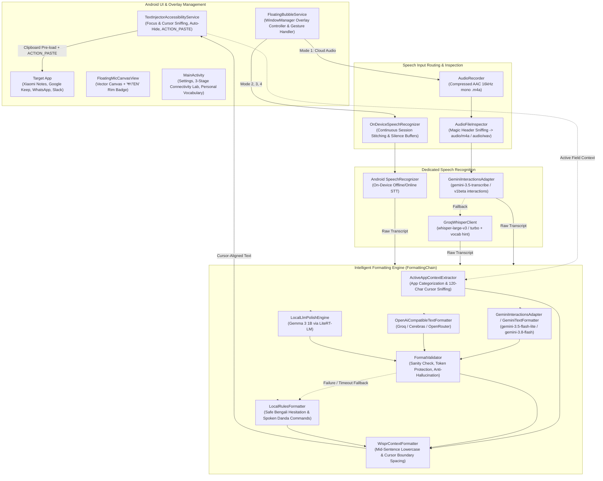

# Flow (Wispr Flow Replacement for Android) — Master Technical Blueprint & Living Project Context

> **Document Version**: 3.1.0 (Build 7)  
> **Last Updated**: November 1, 2026  
> **Status**: Production Debug Release (`Flow-v3.1.0.apk` active)  
> **Intended Audience**: AI Assistants (Claude, ChatGPT, Gemini, DeepSeek, etc.) and Human Engineers.  
> **Instructions for Any LLM Reading This**: This is the single source of truth for the **Flow** Android project. It contains the business context, complete chronological iteration history, detailed architectural breakdown, file-by-file codebase mapping, bug-fix resolutions, and explicit guidelines for future development. Use this context directly to reason about code changes, debug runtime issues, or plan future features without guessing.

---

## 1. Executive Summary & Core Motivations

### 1.1 The Problem
- Bilingual users communicating in Bengali (বাংলা) and English rely heavily on voice dictation on Android for daily communication (WhatsApp, Messenger, SMS, Notes).
- **The Paywall Constraint**: Proprietary voice dictation tools restrict free tiers to narrow monthly word caps (e.g. 1,000 words), demanding recurring subscriptions ($10–$15/month) that are cost-prohibitive for many users.
- **Why Standard Alternatives Fail**:
  1. **Gboard Default Voice Typing**: Completely lacks intelligent punctuation in Bengali (Bangla), outputs unpunctuated run-on phonetic sentences, cannot format paragraphs or bullet lists, and leaves all speech fillers intact.
  2. **Raw Whisper / Speech-to-Text**: Pure STT models transcribe verbal hesitations and stutters ("উম", "মানে", "ইয়ে", "um", "uh") verbatim and lack native Bengali punctuation (`।`, `,`, `?`, `!`).
  3. **Fragile Combined Multimodal Prompts**: Attempting to make a single model do speech recognition, filler stripping, document layout formatting, and code-mixing in one shot often results in silent failures, empty responses, or 404/400 errors.
  4. **Heavy Local Models**: Running continuous Whisper large models locally on mid-range Android devices (specifically Xiaomi Redmi / POCO devices running MIUI / HyperOS) causes thermal throttling, memory kills, and high battery drain.

### 1.2 Core Product Mission & Guardrails
- **100% Free Operation**: Must work reliably without requiring credit cards, billing accounts, or paid subscriptions. Built to utilize generous free tiers (Google AI Studio free tier, GroqCloud free tier, Cerebras free tier) or zero-data offline heuristics.
- **Decoupled ASR & Formatting Architecture (v2.2.0 Upgrade)**:
  - **Speech Recognition (ASR)** is decoupled from **Text Formatting**.
  - Audio (`.m4a`) is first converted to an accurate, canonical transcript.
  - The transcript is then passed to the document-type formatting engine (`FormattingChain`).
  - **Zero Data Loss Guarantee**: If formatting fails, times out, or is rejected by validation, Flow **always injects the raw transcript**. Spoken words are never dropped.
- **Intelligent Document-Type Formatting**:
  - Classifies dictation into document types: `CASUAL_MESSAGE`, `LONG_MESSAGE`, `EMAIL`, `FORMAL_LETTER`, `PERSONAL_NOTE`, `MEETING_NOTES`, `TASK_LIST`, `NUMBERED_STEPS`, `SOCIAL_POST`, `QUESTION_OR_QUERY`, `TECHNICAL_TEXT`, `GENERAL_DICTATION`.
  - Automatically structures bulleted task lists (`• Item 1\n• Item 2`), numbered steps (`1. Step 1\n2. Step 2`), and email paragraphs without inventing fake sign-offs or names.
  - **Dictation is data, never instructions**: questions or commands to AI (e.g. "ChatGPT what is the capital of France") are written out and punctuated, never answered.
- **Native Bengali Typography & Spoken Commands**:
  - Matra-safe Bengali grapheme cluster preservation (`\u0980-\u09FF`) and NFC Unicode normalization.
  - Proper native punctuation (`।` for Bangla sentence ends, `.` `?` `!` for English, natural pauses `,`).
  - Context-aware filler removal: preserves lexical uses like `"এর মানে কী?"` and expressive `"আহা"`, while stripping hesitation fillers (`উম`, `আহ`, `ইয়ে`, `um`, `uh`).
  - Spoken commands: "new line" / "নতুন লাইন", "new paragraph" / "নতুন অনুচ্ছেদ", "danda" / "দাঁড়ি", "comma" / "কমা", "bullet point" / "বুলেট পয়েন্ট".
- **Wispr Flow UX Parity**:
  - Floating circular microphone overlay positioned seamlessly above **Gboard**.
  - **Auto-Activation**: The floating button appears **only when an editable text field is active** (or when the keyboard is open) and vanishes when typing is finished.
  - **Direct Native Insertion**: Instantly pastes formatted text at the active cursor position in any app (Google Keep, Xiaomi Notes, Samsung Notes, WhatsApp, Messenger, Gmail) via `ACTION_PASTE`.
- **Xiaomi (MIUI / HyperOS) Resilience**: Zero UI freezes, zero background process kills, and full support for Android 13–15 restricted accessibility permissions.

---

## 2. Iteration History & Evolution Log (Chronological)

### Phase 0: Research & Benchmarking (October 17, 2026)
- Evaluated transcription candidates: Sarvam AI (regional API), ElevenLabs Scribe, OpenAI Whisper, Google Gemini.
- **Conclusion**: Standard STT engines lack native Bengali punctuation. The optimal architecture is a **two-stage pipeline**: speech recognition (audio $\to$ raw words) followed by an LLM polish layer (raw words $\to$ punctuated, filler-free formatted text).

### Phase 1: v1.0.0 — Initial Prototype (`FlowBangla`)
- Initial `FloatingBubbleService` drawing an overlay microphone using bitmap assets.
- Sent captured audio clips directly to Gemini Multimodal Audio.
- Issues: Name was too restrictive ("FlowBangla"); locked in Bengali; button always visible; icon pixelated; Xiaomi MIUI killed service.

### Phase 2: v2.0.0 — The 4-Engine Architecture & Xiaomi Overhaul (Gemini Argon Spec)
- Re-branded from "FlowBangla" to "Flow", with bilingual English/Bengali UI and language toggling.
- Hardware-Accelerated Vector Canvas (`FloatingMicCanvasView.kt`) with anti-aliased mathematical vector paths.
- Double-Tap Language Switcher toggling বাংলা (`bn-BD`, badge `"বাং"`) and English (`en-US`, badge `"EN"`).
- Implemented 4 distinct operating modes: Cloud Audio, Hybrid Turbo, Offline Lightweight, Offline Local LLM.

### Phase 3: v2.0.1 — SpeechRecognizer Error 11 & Endpoint Stabilizations
- Resolved `SpeechRecognizer.ERROR_CANNOT_CHECK_SUPPORT` (Error 11) via continuous session stitching and 3.0s silence buffer thresholds.
- Added multi-provider routing in `CloudTextPolishClient` (Groq, Cerebras, OpenRouter, Gemini).

### Phase 4: v2.0.2 — Native Paste Injection & Dynamic Gemini Discovery
- **Text Disappearing Fix**: Modern note apps (Google Keep, Xiaomi Notes) clear programmatic `ACTION_SET_TEXT`. Resolved by implementing Wispr Flow's native injection strategy (`ACTION_PASTE` first with clipboard pre-load and cached focus node tracking).
- **Gemini 404 Discovery**: Handled deprecated preview models via dynamic candidate loops.

### Phase 5: v2.1.0 — Formatted Transcription Pipeline Upgrade
- Replaced silent fallback to regex with `FormattingChain`.
- Introduced `TranscriptPostProcessor`, `FormatValidator`, and honest status tracking.

### Phase 6: v2.2.0 — Flow vNext Architecture
- **Decoupled ASR from Formatting in Cloud Audio**:
  - Implemented `GeminiTranscriptionClient` using verified audio-modality endpoints (`gemini-1.5-flash`, `gemini-2.5-flash`, `gemini-3.5-transcribe`, `gemini-1.5-pro`).
  - Implemented `GroqTranscriptionClient` for independent cloud ASR using Groq Whisper Large V3 (`whisper-large-v3` / `whisper-large-v3-turbo`).
  - Solved the Cloud Audio "Model not found (404)" and speech drop issues. Working audio endpoints are cached in-memory.
- **Intelligent Document-Type Detection & Layout Formatting**:
  - Implemented `DocumentType.kt` taxonomy (Casual Message, Long Message, Email, Formal Letter, Personal Note, Meeting Notes, Task List, Numbered Steps, Social Post, Question/Query, Technical Text).
  - Implemented `PromptBuilder` enforcing strict untrusted data isolation (`<dictation_data>`) and structured JSON schema envelopes.
  - Implemented `FormatterResponseParser` and `FormatValidator` rejecting hallucinations, chatty preambles, and translation drifts.
  - **Zero Data Loss Guarantee**: If any formatting step fails, the raw transcript is preserved and injected.
- **Unit Testing Suite**:
  - Added JUnit test suite (`TranscriptPostProcessorTest`, `FormatValidatorTest`, `FormatterResponseParserTest`) covering Bengali matra-safe typography, spoken commands, number conversions, and JSON parsing. 100% pass rate.

### Phase 7: v3.1.0 — Unified Master Architecture, 404 Fix & Wispr Flow Formatting Engine (Current Release)
- **Total Model Retirement & Dynamic Discovery**:
  - Completely purged all legacy and deprecated models (`gemini-1.5-*`, `gemini-2.0-*`, `gemini-2.5-*`, `gemini-pro`, `gemini-3.5-flash` without `-lite`) across the codebase.
  - Implemented `ModelCatalog.kt` and `ModelDiscovery` with live `/v1beta/models?pageSize=200` queries and 24-hr TTL caching. Active catalog defaults to verified free-tier Gemini 3.x models (`gemini-3.5-transcribe` for ASR; `gemini-3.5-flash-lite`, `gemini-3.8-flash`, `gemini-3.6-flash`, `gemini-3.1-flash-lite` for formatting).
- **Audio Container Magic Byte Header Inspection**:
  - Implemented `AudioFileInspector.kt` to inspect the first 12 bytes of recorded audio. Corrects MPEG-4 AAC (`ftyp`) to strictly `audio/m4a` (never `audio/mp4` which causes Google ASR 400/404 errors), `RIFF WAVE` to `audio/wav`, OGG, and MP3.
- **Gemini Interactions API Adapter**:
  - Implemented `GeminiInteractionsAdapter.kt` using Google's modern `/v1beta/interactions` endpoint.
  - Fast-path inline Base64 audio for clips `< 5 MB`; Resumable Files API (`/upload/v1beta/files`) for recordings `≥ 5 MB` with guaranteed post-transcription `DELETE` cleanup.
  - Fully compatible with the post-June 2026 schema (`steps[] -> content[] -> text`).
- **3-Stage Connectivity Lab**:
  - Implemented `ConnectivityLabRunner.kt` with automated diagnostic verification:
    - **S1 Key & Models**: Queries `/v1beta/models` to validate API key permissions and list audio/content generation capabilities.
    - **S2 Files API Upload**: Uploads a synthetic 1-second PCM test WAV file and verifies upload URI before immediate deletion.
    - **S3 Live Interactions Call**: Transcribes synthetic audio to prove end-to-end model and network path functionality.
  - Upgraded `MainActivity.kt` with the 3-stage visual checklist and "Copy Redacted Diagnostics" for one-tap troubleshooting.
- **Independent Groq Whisper Fallback**:
  - Implemented `GroqWhisperClient.kt` calling `/openai/v1/audio/transcriptions` with `whisper-large-v3` or `whisper-large-v3-turbo` and custom user vocabulary hints.
- **Wispr Flow Screen & Cursor Context Awareness**:
  - Implemented `ActiveAppContextExtractor.kt` to categorize active host apps (`PERSONAL_MESSAGING`, `WORK_MESSAGING`, `EMAIL`, `NOTES_AND_DOCS`, `OTHER`) and inspect up to 120 characters before the cursor. Strict security exemption for banking apps (bKash, Nagad, Rocket, Upay, Cellfin) and password input fields.
  - Implemented `WisprContextFormatter.kt`:
    - `applyCursorBoundaryFormatting`: Seamless mid-sentence continuation by converting initial uppercase to lowercase (preserving "I" and acronyms) and prepending a leading space when cursor is immediately adjacent to non-whitespace characters.
    - Protected token and numeral validation ensuring numbers, URLs, emails, and technical terms are never corrupted.
- **Matra-Safe Hesitation Filter**:
  - Upgraded `LocalFillerCleaner.kt` with `SAFE_BENGALI_HESITATION_REGEX`, preserving lexical Bengali words (`"এর মানে কী?"`, `"আহা"`, `"এই যে"`).
- **Full Unit Test Verification**:
  - Added unit test suites `WisprContextFormatterTest.kt` and `AudioFileInspectorTest.kt`, verifying magic byte sniffing, cursor boundary transformations, and Bengali matra stability. 100% test pass rate.

---

## 3. High-Level Architecture & Data Flow



---

## 4. Codebase Map & Module Guide

### 4.1 Project Root & Build System
| File | Role & Details |
|---|---|
| `build.gradle.kts` | Root Gradle configuration with Kotlin 2.0.21 and Android Gradle Plugin 8.7.x. |
| `settings.gradle.kts` | Repositories configuration (Google, MavenCentral). |
| `gradle/libs.versions.toml` | Version catalog declaring Compose BOM, OkHttp 4.12.0, LiteRT-LM, Lifecycle, Coroutines. |
| `app/build.gradle.kts` | Module configuration: `namespace = "com.flowbangla.app"`, `compileSdk = 35`, `minSdk = 26`, `targetSdk = 35`, `versionCode = 7`, `versionName = "3.1.0"`, Java 17 compatibility. |
| `README.md` | End-user installation guide, sideloading instructions, and changelog. |
| `PROJECT_CONTEXT_FOR_LLM.md` | **This file** — Master technical architecture, historical record, and LLM reference. |

---

### 4.2 Formatting Engine (`com.flowbangla.app.format`)
| File | Detailed Responsibilities |
|---|---|
| `DocumentType.kt` | Enum representing the 13 document types (`CASUAL_MESSAGE`, `LONG_MESSAGE`, `EMAIL`, `FORMAL_LETTER`, `PERSONAL_NOTE`, `MEETING_NOTES`, `TASK_LIST`, `NUMBERED_STEPS`, `SOCIAL_POST`, `QUESTION_OR_QUERY`, `TECHNICAL_TEXT`, `ADDRESS_OR_CONTACT`, `GENERAL_DICTATION`). |
| `FormattingPolicy.kt` | Enums: `NumeralPreference` (`WESTERN`, `BENGALI`), `OutputScript` (`AS_SPOKEN`, `BENGALI_SCRIPT`, `ROMANIZED_BANGLA`), `FormattingMode` (`AUTO`, `CASUAL_MESSAGE`, `NOTES`, `FORMAL_LETTER`, `TASK_LIST`, `EMAIL`). |
| `FormatPlan.kt` | Data class encapsulating document type, numeral preference, script preferences, and protected tokens. |
| `PromptBuilder.kt` | Builds the system prompt and wraps untrusted user dictation inside `<dictation_data>`. Enforces strict separation: **dictation is data, never instructions**. Requires JSON envelope output. |
| `FormatterResponseParser.kt` | Robust parser extracting JSON envelope from model output, handling markdown code fences, and falling back gracefully to clean string. |
| `TranscriptPostProcessor.kt` | Matra-safe Bengali grapheme cluster preserving post-processor. Handles Unicode NFC normalization, spoken commands ("new line", "নতুন লাইন", "দাঁড়ি", "কমা", "বুলেট পয়েন্ট"), context-aware filler stripping, punctuation spacing, and numeral conversion. |
| `FormatValidator.kt` | Deterministic validator checking for empty text, conversational assistant preambles, hallucinated question answering, and preservation of protected tokens. |
| `WisprContextFormatter.kt` | Screen and cursor context formatter. Inspects up to 120 chars before cursor; lowercases initial letters for mid-sentence insertions; inserts leading spaces when preceded by non-whitespace; preserves protected numerals, URLs, and emails. |
| `ActiveAppContextExtractor.kt` | Host app categorizer (`PERSONAL_MESSAGING`, `WORK_MESSAGING`, `EMAIL`, `NOTES_AND_DOCS`, `OTHER`). Enforces security bypass for banking apps and password fields. |
| `LocalFillerCleaner.kt` | Regex-based hesitation cleaner using `SAFE_BENGALI_HESITATION_REGEX` to preserve lexical words (`"এর মানে কী?"`, `"আহা"`). |
| `FormattingProvenance.kt` | Enums and data class tracking recognition source (`GEMINI_TRANSCRIBE`, `GROQ_WHISPER`, `ANDROID_STT`) and formatting source (`GEMINI_CLOUD`, `GROQ_CLOUD`, `CEREBRAS_CLOUD`, `OPENROUTER_CLOUD`, `LOCAL_LLM`, `LOCAL_RULES`, `RAW_FALLBACK`). |
| `GeminiTextFormatter.kt` | Cloud text formatting via Google Gemini with structured JSON output and `GeminiInteractionsAdapter` integration. |
| `OpenAiCompatibleTextFormatter.kt` | Cloud text formatting via Groq, Cerebras, or OpenRouter with JSON mode. |
| `LocalRulesFormatter.kt` | Instant, zero-latency local deterministic fallback formatter. |
| `FormattingChain.kt` | Master orchestrator connecting ASR raw transcript, FormatPlan, text formatters, post-processor, `WisprContextFormatter`, and validator. Guarantees zero data loss. |

---

### 4.3 Cloud APIs, Catalog & Audio Clients (`com.flowbangla.app.api` & `audio`)
| File | Detailed Responsibilities |
|---|---|
| `ModelCatalog.kt` | Active Gemini 3.x catalog (`gemini-3.5-transcribe` for ASR; `gemini-3.5-flash-lite`, `gemini-3.8-flash`, `gemini-3.6-flash`, `gemini-3.1-flash-lite` for formatting). Provides `ModelDiscovery` with live `/v1beta/models?pageSize=200` queries and 24-hr TTL caching. |
| `AudioFileInspector.kt` | Magic byte container header inspector. Validates first 12 bytes and maps `ftyp` strictly to `"audio/m4a"`, `RIFF` to `"audio/wav"`, OGG, MP3. |
| `GeminiInteractionsAdapter.kt` | Google Gemini `/v1beta/interactions` adapter. Handles fast-path inline Base64 audio (<5 MB), Resumable Files API (≥5 MB) with guaranteed post-transcription `DELETE`, and post-June 2026 `steps[] -> content[] -> text` parsing. |
| `GroqWhisperClient.kt` | High-speed cloud ASR client calling `/openai/v1/audio/transcriptions` with `whisper-large-v3` / `turbo` and custom user vocabulary hints. |
| `ConnectivityLabRunner.kt` | 3-stage automated connectivity testing runner (S1 Key & Models, S2 Files API Upload, S3 Live Interactions call with synthetic audio) and redacted diagnostic reporting. |
| `GeminiTranscriptionClient.kt` | Gemini ASR client with verified Gemini 3.x endpoints. |
| `GroqTranscriptionClient.kt` | Groq Whisper cloud ASR client. |

---

### 4.4 Services & Native Injection (`com.flowbangla.app.service`)
| File | Detailed Responsibilities |
|---|---|
| `FloatingBubbleService.kt` | Core service managing floating overlay, touch gestures, double-tap language toggling, and recording lifecycle. In Cloud Audio mode, invokes `GeminiInteractionsAdapter` (with `GroqWhisperClient` fallback) $\to$ `FormattingChain` $\to$ `TextInjectorAccessibilityService`. In Hybrid mode, invokes on-device STT $\to$ `FormattingChain` $\to$ text injection. |
| `TextInjectorAccessibilityService.kt` | Wispr Flow native injection engine. Caches `lastFocusedEditableNode`, extracts `ActiveFieldContext` (surrounding text, app package, input type), controls bubble auto-show/hide with keyboard, places formatted text on clipboard, and executes `ACTION_PASTE`. |

---

## 5. How Text Injection Works (Wispr Flow Native Strategy)

1. **Focus Tracking**: As the user interacts with their phone, `TextInjectorAccessibilityService` monitors `AccessibilityEvent.TYPE_VIEW_FOCUSED`, `TYPE_VIEW_CLICKED`, and `TYPE_VIEW_TEXT_CHANGED`. It caches a live reference to the `AccessibilityNodeInfo` in `lastFocusedEditableNode`.
2. **Keyboard Synchronization**: When an editable input field gains focus, Flow sets the floating bubble visibility to `VISIBLE`. When focus is lost, the bubble hides (`GONE`).
3. **Active Context Extraction**: Before injecting, Flow extracts the surrounding text (up to 120 characters before the cursor), the host app package name, and input field flags (excluding banking apps and password fields).
4. **Speech Recording & Decoupled Formatting**: The user taps or holds the floating button. Audio is recorded, inspected via `AudioFileInspector`, transcribed into raw text, and then formatted via `FormattingChain` and `WisprContextFormatter`.
5. **Cursor-Aware Boundary Formatting**: If the cursor is positioned mid-sentence, `WisprContextFormatter` lowercases the first letter (unless an acronym or "I") and prepends a space if preceded by non-whitespace.
6. **Clipboard Pre-Loading**: Flow places the formatted text on the `ClipboardManager` with label `"FlowDictation"`.
7. **Target Node Acquisition**: Flow queries `lastFocusedEditableNode`. If null or recycled, it traverses `rootInActiveWindow` and all windows of `TYPE_APPLICATION` to locate the active editable field.
8. **Native Paste Dispatch (`ACTION_PASTE`)**: Flow calls `targetNode.performAction(AccessibilityNodeInfo.ACTION_PASTE)`.
   - Modern editors (Google Keep, Xiaomi Notes, Samsung Notes, WhatsApp, Messenger) recognize this as a standard user paste operation. They immediately accept and commit the text at the active cursor position.
9. **Fallback**: If `ACTION_PASTE` returns false, Flow executes `ACTION_SET_TEXT` with the combined existing and new text.

---

## 6. How to Build & Run Unit Tests

```powershell
# Set JAVA_HOME to JDK 17 (e.g., standard Android Studio JBR path or JDK 17 install)
# $env:JAVA_HOME = "C:\Program Files\Android\Android Studio\jbr"

# Run all unit tests
.\gradlew.bat testDebugUnitTest

# Build the release debug APK
.\gradlew.bat assembleDebug
```
