# Flow v3.1 — Unified Master Architecture, 404 Fix & Wispr Flow Formatting Blueprint

> **Purpose of this document**: This is the single, unified engineering specification and step-by-step execution guide for **Antigravity**. It synthesizes the strongest architectural ideas from **ChatGPT** (`FLOW_V_NEXT_IMPLEMENTATION_BRIEF.md`), **Claude** (`FLOW_404_FIX_AND_VNEXT_EXECUTION_PLAN.md`), and **Gemini** (`FLOW_V3_404_FIX_AND_WISPR_FORMATTING_BLUEPRINT.md`), while resolving every open `"VERIFY"` item and schema bug against Google's official October 2026 documentation.

## 1. Executive Synthesis: What We Took from Each Blueprint & What We Fixed

| Component / Idea | Source | Why It Is Included & What Was Corrected for Production |
| :--- | :--- | :--- |
| **Live `ModelDiscovery` + Task-Specific `ModelCatalog` + 3-Stage Connectivity Lab (`S1`–`S3`)** | **Claude** | Prevents hardcoded retired model names from ever causing a `404` again, and separates **Key/Model Discovery (`S1`)**, **Audio Integrity/Upload (`S2`)**, and **Transcription (`S3`)** into a single redacted diagnostic screen. |
| **Critical Fix to Claude's `TranscriptExtractor` (`steps` vs `outputs`)** | **Gemini Verification** | Claude's code parsed `root.optJSONArray("outputs")`. Per [Google's May 2026 Interactions API Breaking Changes](https://ai.google.dev/gemini-api/docs/interactions-breaking-changes-may-2026), the `outputs` array was **permanently removed on June 8, 2026** and replaced by `steps[] -> content[] -> text`. Our unified parser reads `output_text`, `steps[]`, `outputs[]`, and `candidates[]` so it never crashes. |
| **Critical Fix to Claude's `ModelCatalog` (`gemini-3.5-flash` $\to$ `gemini-3.8-flash` / `gemini-3.5-flash-lite`)** | **Gemini Verification** | Claude listed `gemini-3.5-flash`, which does not exist in [Google's Official Models List](https://ai.google.dev/gemini-api/docs/models). The verified active Flash models are `gemini-3.5-flash-lite`, `gemini-3.8-flash`, `gemini-3.6-flash`, and `gemini-3.1-flash-lite`. All four—plus `gemini-3.5-transcribe`—are **Free of charge** on the Google AI Studio Free Tier ([Gemini Pricing Docs](https://ai.google.dev/gemini-api/docs/pricing)). |
| **Separate Dedicated ASR from Intelligent Formatting + Provenance Tracking** | **ChatGPT** | Decouples speech recognition (`gemini-3.5-transcribe` $\to$ Groq `whisper-large-v3` $\to$ Android `SpeechRecognizer`) from formatting, tracks `RecognitionProvenance` and `FormattingProvenance` separately, and guarantees that if formatting fails, the raw transcript is still pasted. |
| **13-Category Document Classifier + Context-Aware Bangla Filler Protection** | **ChatGPT** | Distinguishes casual chat, emails, formal letters, meeting notes, task lists, numbered steps, and technical text; protects semantic Bangla words (`"এর মানে কী?"`, `"আহা"`, `"এই যে"`) while stripping genuine hesitations (`"উম"`, `"অ্যাঁ"`, `"ইয়ে মানে"`). |
| **Wispr Flow Screen & Cursor Context Awareness (`ActiveAppContextExtractor`)** | **Gemini** | Replicates [Wispr Flow's Context Awareness](https://docs.wisprflow.ai/articles/4678293671-feature-context-awareness) using `TextInjectorAccessibilityService` to read the active app package (`WhatsApp` vs `Gmail` vs `Slack` vs `Keep`) and the 120 characters before the cursor (skipping password fields and banking apps like bKash/Nagad) to match mid-sentence lowercase continuation and leading spaces on-device in `<1ms`. |
| **Hybrid Fast-Path Audio Delivery (Inline Base64 `< 5 MB`, Resumable Files API `>= 5 MB`)** | **Gemini + Claude** | Uses single-request inline Base64 audio ([Audio Understanding Docs](https://ai.google.dev/gemini-api/docs/audio)) for normal dictations (`< 5 MB`) to save 800ms of network latency, while keeping Claude's Resumable Files API upload + immediate `DELETE` cleanup for longer recordings. |

## 2. All 7 of Claude's `"VERIFY"` Items — Officially Resolved (31 October 2026)

Claude's Section 12.1 listed 7 items it could not confirm. Every single one has been verified against Google's live documentation:

1. **Exact Active Model IDs ([Gemini Models Page](https://ai.google.dev/gemini-api/docs/models))**:
   - **ASR**: `gemini-3.5-transcribe` (Interactions API).
   - **Formatting & Multimodal Fallback**: `gemini-3.5-flash-lite`, `gemini-3.8-flash`, `gemini-3.6-flash`, `gemini-3.1-flash-lite`.
   - **Retired / Restricted (MUST DELETE)**: `gemini-1.5-*`, `gemini-2.0-*`, `gemini-2.5-*`, `gemini-pro`.
2. **Free-Tier Availability ([Gemini Pricing Page](https://ai.google.dev/gemini-api/docs/pricing))**:
   - `gemini-3.5-transcribe`, `gemini-3.5-flash-lite`, `gemini-3.8-flash`, `gemini-3.6-flash`, and `gemini-3.1-flash-lite` are all listed as **Input price: Free of charge / Output price: Free of charge** on the Free Tier in Google AI Studio.
3. **Exact Audio MIME Types ([Audio Transcription Guide](https://ai.google.dev/gemini-api/docs/transcribe))**:
   - Accepted MIME strings are strictly: `audio/wav`, `audio/mp3`, `audio/aiff`, `audio/aac`, `audio/ogg`, `audio/flac`, `audio/mpeg`, `audio/m4a`, `audio/l16`, `audio/opus`, `audio/alaw`, `audio/mulaw`, `audio/webm`.
   - **Critical Rule**: Android's `MediaRecorder` (`OutputFormat.MPEG_4` + `AudioEncoder.AAC`) writes an MP4/M4A `ftyp` header. You **must** label it `"audio/m4a"` (never `"audio/mp4"`, which is not in the supported audio MIME table).
4. **Exact `mode` Syntax in `transcription_config` ([Audio Transcription Parameter Reference](https://ai.google.dev/gemini-api/docs/transcribe))**:
   - For verbatim mode: `"mode": {"type": "verbatim"}` (an Object).
   - For smart mode: `"mode": "smart"` (a String).
   - **Constraint**: `custom_vocabulary` cannot be combined with `diarization_mode` or `timestamp_granularities`. Since Flow does not use diarization or word timestamps, `custom_vocabulary` works in both verbatim and smart modes.
5. **Files API Auth Header**:
   - `x-goog-api-key: <KEY>` works on both `https://generativelanguage.googleapis.com/upload/v1beta/files` and `https://generativelanguage.googleapis.com/v1beta/interactions`.
6. **Structured JSON Output Schema ([May 2026 Breaking Changes Guide](https://ai.google.dev/gemini-api/docs/interactions-breaking-changes-may-2026))**:
   - On `/v1beta/interactions`, `response_mime_type` was removed. Structured JSON must be requested via top-level:
     ```json
     "response_format": {
       "type": "text",
       "mime_type": "application/json",
       "schema": { ... }
     }
     ```
   - On `/v1beta/models/{model}:generateContent`, structured JSON uses `generationConfig.responseMimeType = "application/json"` and `generationConfig.responseSchema = { ... }`.

## 3. Unified System Architecture

```mermaid
flowchart TD
    subgraph Stage0_UI ["0. Gesture & Screen Context (< 5ms)"]
        A["FloatingMicCanvasView\n• Single Tap / Hold: Record\n• Double Tap (Idle): Toggle বাং (bn-BD) ↔ EN (en-US)"]
        B["ActiveAppContextExtractor\n• Reads packageName -> AppCategory (Chat, Work, Email, Notes)\n• Reads 120 chars before cursor -> isMidSentenceContinuation\n• Skips if isPassword == true or Banking App (bKash/Nagad)"]
    end

    subgraph Stage1_Audio ["1. Audio Capture & Header Inspection"]
        C["AudioRecorder (16kHz Mono AAC in M4A)\n+ AudioFileInspector (Magic-byte check:\nftyp -> audio/m4a, RIFF -> audio/wav, RMS silence check)"]
    end

    subgraph Stage2_ASR ["2. Task-Aware ASR Router"]
        D{"EngineMode & Live ModelCatalog"}
        E["GeminiTranscribeAdapter (Primary Cloud ASR)\nPOST /v1beta/interactions (gemini-3.5-transcribe)\n• < 5MB: Inline Base64 audio/m4a\n• >= 5MB: Resumable Files API + Auto-Delete\n• Custom Vocabulary Biasing (up to 100 terms)"]
        F["GroqWhisperClient (Secondary Cloud ASR)\nPOST /openai/v1/audio/transcriptions\n• Model: whisper-large-v3"]
        G["OnDeviceSpeechRecognizer\n(Android SpeechRecognizer\nOffline bn-BD / en-US)"]
    end

    subgraph Stage3_Format ["3. Context-Aware Wispr Formatting Pipeline"]
        H["WisprFormattingChain\n• ProtectedTokenExtractor (Names, URLs, Numbers, Code)\n• DocumentTypeClassifier (13 types: Email, Chat, Notes, List...)\n• Cloud Formatter (gemini-3.5-flash-lite / gemini-3.8-flash / Groq Llama 3.3 70B)\n• Offline Fallback: LocalLlmPolishEngine (LiteRT-LM) -> LocalFillerCleaner"]
        I["FormatValidator & Cursor Boundary Aligner\n• Rejects empty/chatbot/translated output -> keeps Raw Transcript\n• Matches leading space & mid-sentence lowercase to cursor text"]
    end

    subgraph Stage4_Inject ["4. Native Injection & Provenance"]
        J["TextInjectorAccessibilityService\n(Clipboard Pre-load + ACTION_PASTE)\n+ HistoryManager (Stores ASR + Formatter Provenance)"]
    end

    A --> B --> C --> D
    D -- "CLOUD_AUDIO" --> E
    E -- "On Error / Quota 429" --> F
    F -- "If Offline" --> G
    D -- "HYBRID / OFFLINE" --> G
    E --> H
    F --> H
    G --> H
    H --> I --> J
```



## 4. Production Kotlin Implementation (Core Modules)

### 4.1 `ModelDiscovery.kt` & `ModelCatalog.kt` (Runtime Model Verification & Caching)

Create `app/src/main/java/com/flowbangla/app/api/ModelCatalog.kt`:

```kotlin
package com.flowbangla.app.api

import okhttp3.OkHttpClient
import okhttp3.Request
import org.json.JSONObject

enum class ModelTask {
    AUDIO_TRANSCRIPTION,
    MULTIMODAL_AUDIO_FALLBACK,
    TEXT_FORMATTING
}

enum class ApiRoute {
    INTERACTIONS,     // POST https://generativelanguage.googleapis.com/v1beta/interactions
    GENERATE_CONTENT  // POST https://generativelanguage.googleapis.com/v1beta/models/{id}:generateContent
}

data class RemoteModel(
    val id: String,
    val methods: Set<String>
)

data class ModelSpec(
    val id: String,
    val task: ModelTask,
    val route: ApiRoute,
    val requiredMethod: String? = null
)

class FlowApiException(
    val httpCode: Int,
    val category: ErrorCategory,
    val detail: String
) : Exception("[$category] HTTP $httpCode: $detail")

enum class ErrorCategory {
    AUDIO_EMPTY_OR_SILENT,
    AUDIO_FILE_INVALID,
    AUDIO_MIME_MISMATCH,
    UPLOAD_FAILED,
    MODEL_NOT_AVAILABLE,
    AUTHENTICATION_FAILED,
    QUOTA_EXCEEDED,
    REQUEST_REJECTED,
    PROVIDER_SERVER_ERROR,
    NETWORK_TIMEOUT,
    PROVIDER_RETURNED_NO_TRANSCRIPT,
    RESPONSE_PARSE_FAILED
}

object ModelCatalog {

    // Verified October 2026 Active Gemini 3.x Catalogue.
    // STRICT RULE: NEVER add gemini-1.5-*, gemini-2.0-*, or gemini-2.5-* here.
    val specs: List<ModelSpec> = listOf(
        // 1. Dedicated Speech-to-Text (Primary Cloud ASR)
        ModelSpec(
            id = "gemini-3.5-transcribe",
            task = ModelTask.AUDIO_TRANSCRIPTION,
            route = ApiRoute.INTERACTIONS,
            requiredMethod = null
        ),

        // 2. Multimodal Audio Fallback (if gemini-3.5-transcribe is unavailable for a key)
        ModelSpec(
            id = "gemini-3.8-flash",
            task = ModelTask.MULTIMODAL_AUDIO_FALLBACK,
            route = ApiRoute.INTERACTIONS,
            requiredMethod = null
        ),
        ModelSpec(
            id = "gemini-3.5-flash-lite",
            task = ModelTask.MULTIMODAL_AUDIO_FALLBACK,
            route = ApiRoute.INTERACTIONS,
            requiredMethod = null
        ),
        ModelSpec(
            id = "gemini-3.6-flash",
            task = ModelTask.MULTIMODAL_AUDIO_FALLBACK,
            route = ApiRoute.INTERACTIONS,
            requiredMethod = null
        ),

        // 3. Fast Text Formatting & Document Classification
        ModelSpec(
            id = "gemini-3.5-flash-lite",
            task = ModelTask.TEXT_FORMATTING,
            route = ApiRoute.INTERACTIONS,
            requiredMethod = null
        ),
        ModelSpec(
            id = "gemini-3.8-flash",
            task = ModelTask.TEXT_FORMATTING,
            route = ApiRoute.INTERACTIONS,
            requiredMethod = null
        ),
        ModelSpec(
            id = "gemini-3.6-flash",
            task = ModelTask.TEXT_FORMATTING,
            route = ApiRoute.INTERACTIONS,
            requiredMethod = null
        ),
        ModelSpec(
            id = "gemini-3.1-flash-lite",
            task = ModelTask.TEXT_FORMATTING,
            route = ApiRoute.INTERACTIONS,
            requiredMethod = null
        )
    )

    @Volatile
    private var cachedLiveModels: List<RemoteModel> = emptyList()
    @Volatile
    private var cacheTimestampMs: Long = 0L
    private val disabledForSession = mutableSetOf<String>()

    private const val CACHE_TTL_MS = 24 * 60 * 60 * 1000L // 24 hours

    fun normalizeId(rawName: String): String = rawName.trim().removePrefix("models/")

    fun markModelUnavailableForSession(modelId: String) {
        disabledForSession.add(normalizeId(modelId))
    }

    fun invalidateCache() {
        cachedLiveModels = emptyList()
        cacheTimestampMs = 0L
        disabledForSession.clear()
    }

    fun getOrFetchLiveModels(http: OkHttpClient, rawApiKey: String, forceRefresh: Boolean = false): List<RemoteModel> {
        val cleanKey = rawApiKey.trim()
        if (cleanKey.isEmpty()) {
            throw FlowApiException(400, ErrorCategory.AUTHENTICATION_FAILED, "Gemini API key is empty.")
        }

        val now = System.currentTimeMillis()
        if (!forceRefresh && cachedLiveModels.isNotEmpty() && (now - cacheTimestampMs) < CACHE_TTL_MS) {
            return cachedLiveModels
        }

        val request = Request.Builder()
            .url("https://generativelanguage.googleapis.com/v1beta/models?pageSize=200")
            .header("x-goog-api-key", cleanKey)
            .get()
            .build()

        http.newCall(request).execute().use { response ->
            val body = response.body?.string().orEmpty()
            if (!response.isSuccessful) {
                val category = mapHttpToErrorCategory(response.code, body)
                throw FlowApiException(response.code, category, parseShortError(body))
            }

            val modelsArray = JSONObject(body).optJSONArray("models") ?: return emptyList()
            val parsed = (0 until modelsArray.length()).mapNotNull { idx ->
                val obj = modelsArray.optJSONObject(idx) ?: return@mapNotNull null
                val name = obj.optString("name", "")
                if (name.isBlank()) return@mapNotNull null
                val methodsJson = obj.optJSONArray("supportedGenerationMethods")
                val methods = if (methodsJson == null) emptySet() else {
                    (0 until methodsJson.length()).mapNotNull { mIdx -> methodsJson.optString(mIdx) }.toSet()
                }
                RemoteModel(id = normalizeId(name), methods = methods)
            }

            cachedLiveModels = parsed
            cacheTimestampMs = now
            return parsed
        }
    }

    fun selectCandidates(task: ModelTask, liveModels: List<RemoteModel>): List<ModelSpec> {
        val liveIds = liveModels.associateBy { it.id }
        return specs.filter { spec ->
            spec.task == task &&
                spec.id !in disabledForSession &&
                liveIds.containsKey(spec.id) &&
                (spec.requiredMethod == null || liveIds[spec.id]?.methods?.contains(spec.requiredMethod) == true)
        }
    }

    fun mapHttpToErrorCategory(httpCode: Int, body: String): ErrorCategory {
        val lower = body.lowercase()
        return when (httpCode) {
            400 -> if ("api key not valid" in lower || "api_key_invalid" in lower) {
                ErrorCategory.AUTHENTICATION_FAILED
            } else {
                ErrorCategory.REQUEST_REJECTED
            }
            401, 403 -> ErrorCategory.AUTHENTICATION_FAILED
            404 -> ErrorCategory.MODEL_NOT_AVAILABLE
            429 -> ErrorCategory.QUOTA_EXCEEDED
            in 500..599 -> ErrorCategory.PROVIDER_SERVER_ERROR
            else -> ErrorCategory.REQUEST_REJECTED
        }
    }

    fun parseShortError(rawBody: String): String {
        return try {
            JSONObject(rawBody).optJSONObject("error")?.optString("message")?.take(160)
                ?: rawBody.take(160)
        } catch (_: Exception) {
            rawBody.take(160)
        }
    }
}
```

### 4.2 `AudioFileInspector.kt` (Magic-Byte Container & MIME Inspector)

Never guess the MIME type from the filename extension alone. `AudioFileInspector.kt` reads the first 12 bytes of the recorded file to verify the container header and maps it to the exact MIME string accepted by [`gemini-3.5-transcribe`](https://ai.google.dev/gemini-api/docs/transcribe).

Create `app/src/main/java/com/flowbangla/app/audio/AudioFileInspector.kt`:

```kotlin
package com.flowbangla.app.audio

import com.flowbangla.app.api.ErrorCategory
import com.flowbangla.app.api.FlowApiException
import java.io.File
import java.io.FileInputStream

data class AudioIntegrityMetadata(
    val fileSizeBytes: Long,
    val detectedContainer: String,
    val verifiedMimeType: String
)

object AudioFileInspector {

    // Official supported MIME strings for gemini-3.5-transcribe
    val SUPPORTED_GEMINI_AUDIO_MIMES = setOf(
        "audio/wav", "audio/mp3", "audio/aiff", "audio/aac", "audio/ogg",
        "audio/flac", "audio/mpeg", "audio/m4a", "audio/l16", "audio/opus",
        "audio/alaw", "audio/mulaw", "audio/webm"
    )

    fun inspectAndValidate(file: File): AudioIntegrityMetadata {
        if (!file.exists() || file.length() < 256L) {
            throw FlowApiException(
                httpCode = 0,
                category = ErrorCategory.AUDIO_EMPTY_OR_SILENT,
                detail = "Recorded audio file is missing or under 256 bytes (${file.length()} B)."
            )
        }

        val header = ByteArray(12)
        val readCount = FileInputStream(file).use { it.read(header) }
        if (readCount < 12) {
            throw FlowApiException(0, ErrorCategory.AUDIO_FILE_INVALID, "Could not read 12-byte audio header.")
        }

        // 1. Check ISO Base Media File Format (MP4 / M4A): bytes 4..7 == "ftyp"
        val isFtyp = header[4] == 'f'.code.toByte() &&
            header[5] == 't'.code.toByte() &&
            header[6] == 'y'.code.toByte() &&
            header[7] == 'p'.code.toByte()

        // 2. Check RIFF WAVE: bytes 0..3 == "RIFF" and bytes 8..11 == "WAVE"
        val isWav = header[0] == 'R'.code.toByte() &&
            header[1] == 'I'.code.toByte() &&
            header[2] == 'F'.code.toByte() &&
            header[3] == 'F'.code.toByte() &&
            header[8] == 'W'.code.toByte() &&
            header[9] == 'A'.code.toByte() &&
            header[10] == 'V'.code.toByte() &&
            header[11] == 'E'.code.toByte()

        // 3. Check Ogg container: bytes 0..3 == "OggS"
        val isOgg = header[0] == 'O'.code.toByte() &&
            header[1] == 'g'.code.toByte() &&
            header[2] == 'g'.code.toByte() &&
            header[3] == 'S'.code.toByte()

        // 4. Check ADTS AAC stream: syncword 0xFFF (byte[0] == 0xFF and (byte[1] & 0xF0) == 0xF0)
        val isAdtsAac = (header[0].toInt() and 0xFF) == 0xFF &&
            (header[1].toInt() and 0xF6) == 0xF0

        // 5. Check MP3 (ID3 tag or MPEG sync)
        val isMp3 = (header[0] == 'I'.code.toByte() && header[1] == 'D'.code.toByte() && header[2] == '3'.code.toByte()) ||
            ((header[0].toInt() and 0xFF) == 0xFF && (header[1].toInt() and 0xE0) == 0xE0)

        val (container, mime) = when {
            isFtyp -> "MP4/M4A (ftyp)" to "audio/m4a" // MUST be audio/m4a for gemini-3.5-transcribe
            isWav -> "RIFF WAVE" to "audio/wav"
            isOgg -> "Ogg" to "audio/ogg"
            isAdtsAac -> "ADTS AAC" to "audio/aac"
            isMp3 -> "MP3" to "audio/mp3"
            else -> throw FlowApiException(
                httpCode = 0,
                category = ErrorCategory.AUDIO_MIME_MISMATCH,
                detail = "Unrecognized audio file header magic bytes."
            )
        }

        if (mime !in SUPPORTED_GEMINI_AUDIO_MIMES) {
            throw FlowApiException(0, ErrorCategory.AUDIO_MIME_MISMATCH, "Unsupported MIME: $mime")
        }

        return AudioIntegrityMetadata(
            fileSizeBytes = file.length(),
            detectedContainer = container,
            verifiedMimeType = mime
        )
    }
}
```

### 4.3 `GeminiInteractionsAdapter.kt` (Unified Interactions API Client for ASR & Formatting)

Handles:
- **Inline Base64 Audio** for clips under `5 MB` (single network trip, ~600ms faster on mobile networks).
- **Resumable Files API Upload + Automatic `DELETE` Cleanup** for clips `>= 5 MB` or when running `Stage S2` in the Connectivity Lab.
- **Post-May-2026 `steps` Array Parser** (`steps[] -> content[] -> text`) with backwards-compatible fallback for `output_text`, `outputs[]`, and `candidates[]`.

Create `app/src/main/java/com/flowbangla/app/api/GeminiInteractionsAdapter.kt`:

```kotlin
package com.flowbangla.app.api

import android.util.Base64
import android.util.Log
import com.flowbangla.app.audio.AudioFileInspector
import kotlinx.coroutines.Dispatchers
import kotlinx.coroutines.withContext
import okhttp3.MediaType.Companion.toMediaType
import okhttp3.OkHttpClient
import okhttp3.Request
import okhttp3.RequestBody.Companion.toRequestBody
import org.json.JSONArray
import org.json.JSONObject
import java.io.File

data class UploadedFileHandle(
    val name: String, // e.g. "files/abc123xyz" for DELETE cleanup
    val uri: String,
    val mimeType: String
)

data class InteractionCallResult(
    val text: String,
    val modelId: String,
    val latencyMs: Long
)

class GeminiInteractionsAdapter(
    private val http: OkHttpClient
) {
    companion object {
        private const val BASE_URL = "https://generativelanguage.googleapis.com"
        private const val INTERACTIONS_URL = "$BASE_URL/v1beta/interactions"
        private const val INLINE_AUDIO_MAX_BYTES = 5 * 1024 * 1024L // 5 MB threshold
        private val JSON_MEDIA = "application/json; charset=utf-8".toMediaType()
    }

    /**
     * Step 1 (Optional / Large Files / Connectivity Lab S2):
     * Uploads audio via the Resumable Files API and returns its URI + resource name.
     */
    fun uploadAudioResumable(bytes: ByteArray, mimeType: String, displayName: String, rawApiKey: String): UploadedFileHandle {
        val key = rawApiKey.trim()
        val startBody = JSONObject()
            .put("file", JSONObject().put("display_name", displayName))
            .toString()
            .toRequestBody(JSON_MEDIA)

        val startReq = Request.Builder()
            .url("$BASE_URL/upload/v1beta/files")
            .header("x-goog-api-key", key)
            .header("X-Goog-Upload-Protocol", "resumable")
            .header("X-Goog-Upload-Command", "start")
            .header("X-Goog-Upload-Header-Content-Length", bytes.size.toString())
            .header("X-Goog-Upload-Header-Content-Type", mimeType)
            .post(startBody)
            .build()

        val uploadUrl = http.newCall(startReq).execute().use { resp ->
            val body = resp.body?.string().orEmpty()
            if (!resp.isSuccessful) {
                throw FlowApiException(resp.code, ErrorCategory.UPLOAD_FAILED, ModelCatalog.parseShortError(body))
            }
            resp.header("x-goog-upload-url")
                ?: throw FlowApiException(resp.code, ErrorCategory.UPLOAD_FAILED, "Missing x-goog-upload-url header")
        }

        val uploadReq = Request.Builder()
            .url(uploadUrl)
            .header("X-Goog-Upload-Offset", "0")
            .header("X-Goog-Upload-Command", "upload, finalize")
            .post(bytes.toRequestBody(mimeType.toMediaType()))
            .build()

        return http.newCall(uploadReq).execute().use { resp ->
            val body = resp.body?.string().orEmpty()
            if (!resp.isSuccessful) {
                throw FlowApiException(resp.code, ErrorCategory.UPLOAD_FAILED, ModelCatalog.parseShortError(body))
            }
            val fileObj = JSONObject(body).getJSONObject("file")
            UploadedFileHandle(
                name = fileObj.optString("name", ""),
                uri = fileObj.getString("uri"),
                mimeType = mimeType
            )
        }
    }

    /**
     * Deletes an uploaded file from Google's Files API immediately after transcription finishes.
     */
    fun deleteUploadedFileQuietly(fileName: String, rawApiKey: String) {
        if (fileName.isBlank()) return
        try {
            val cleanName = fileName.removePrefix("/")
            val req = Request.Builder()
                .url("$BASE_URL/v1beta/$cleanName")
                .header("x-goog-api-key", rawApiKey.trim())
                .delete()
                .build()
            http.newCall(req).execute().close()
        } catch (_: Exception) {
        }
    }

    /**
     * Transcribes an audio file using live-discovered `gemini-3.5-transcribe` (or multimodal fallback).
     */
    suspend fun transcribeAudioFile(
        audioFile: File,
        rawApiKey: String,
        languageCodes: List<String> = emptyList(), // Empty = automatic Bangla + English code-switching
        customVocabulary: List<String> = emptyList(),
        useVerbatimMode: Boolean = true,
        forceFilesApiUpload: Boolean = false
    ): InteractionCallResult = withContext(Dispatchers.IO) {
        val key = rawApiKey.trim()
        val audioMeta = AudioFileInspector.inspectAndValidate(audioFile)
        val liveModels = ModelCatalog.getOrFetchLiveModels(http, key)

        val asrCandidates = ModelCatalog.selectCandidates(ModelTask.AUDIO_TRANSCRIPTION, liveModels)
        val fallbackCandidates = ModelCatalog.selectCandidates(ModelTask.MULTIMODAL_AUDIO_FALLBACK, liveModels)

        if (asrCandidates.isEmpty() && fallbackCandidates.isEmpty()) {
            throw FlowApiException(
                httpCode = 404,
                category = ErrorCategory.MODEL_NOT_AVAILABLE,
                detail = "No supported Gemini 3.x transcription models found for this API key."
            )
        }

        val audioBytes = audioFile.readBytes()
        var uploadedHandle: UploadedFileHandle? = null

        try {
            val useUpload = forceFilesApiUpload || audioMeta.fileSizeBytes >= INLINE_AUDIO_MAX_BYTES
            val audioInputItem = if (useUpload) {
                uploadedHandle = uploadAudioResumable(audioBytes, audioMeta.verifiedMimeType, audioFile.name, key)
                JSONObject().apply {
                    put("type", "audio")
                    put("uri", uploadedHandle.uri)
                    put("mime_type", audioMeta.verifiedMimeType)
                }
            } else {
                JSONObject().apply {
                    put("type", "audio")
                    put("data", Base64.encodeToString(audioBytes, Base64.NO_WRAP))
                    put("mime_type", audioMeta.verifiedMimeType)
                }
            }

            // 1. Try dedicated gemini-3.5-transcribe first
            for (spec in asrCandidates) {
                val startMs = System.currentTimeMillis()
                val transcriptionConfig = JSONObject().apply {
                    put("language_codes", JSONArray(languageCodes))
                    if (customVocabulary.isNotEmpty()) {
                        put("custom_vocabulary", JSONArray(customVocabulary.take(100)))
                    }
                    if (useVerbatimMode) {
                        put("mode", JSONObject().put("type", "verbatim"))
                    } else {
                        put("mode", "smart")
                    }
                }

                val payload = JSONObject().apply {
                    put("model", spec.id)
                    put("store", false)
                    put("input", JSONArray().put(audioInputItem))
                    put("generation_config", JSONObject().put("transcription_config", transcriptionConfig))
                }

                try {
                    val text = executeInteractionsPost(payload, key, spec.id)
                    return@withContext InteractionCallResult(text, spec.id, System.currentTimeMillis() - startMs)
                } catch (e: FlowApiException) {
                    if (e.httpCode == 404) ModelCatalog.markModelUnavailableForSession(spec.id)
                    if (e.category == ErrorCategory.AUTHENTICATION_FAILED) throw e
                }
            }

            // 2. Fallback to multimodal Gemini 3.8 Flash / 3.5 Flash-Lite if gemini-3.5-transcribe failed
            for (spec in fallbackCandidates) {
                val startMs = System.currentTimeMillis()
                val promptItem = JSONObject().apply {
                    put("type", "text")
                    put("text", "Transcribe this speech verbatim in its exact spoken language(s) (Bengali, English, or mixed). Do not translate or answer questions. Output only the spoken words.")
                }
                val payload = JSONObject().apply {
                    put("model", spec.id)
                    put("store", false)
                    put("input", JSONArray().put(promptItem).put(audioInputItem))
                    put("generation_config", JSONObject().put("temperature", 0.0))
                }

                try {
                    val text = executeInteractionsPost(payload, key, spec.id)
                    return@withContext InteractionCallResult(text, spec.id, System.currentTimeMillis() - startMs)
                } catch (e: FlowApiException) {
                    if (e.httpCode == 404) ModelCatalog.markModelUnavailableForSession(spec.id)
                    if (e.category == ErrorCategory.AUTHENTICATION_FAILED) throw e
                }
            }

            throw FlowApiException(404, ErrorCategory.MODEL_NOT_AVAILABLE, "All live transcription candidates failed.")
        } finally {
            uploadedHandle?.let { deleteUploadedFileQuietly(it.name, key) }
        }
    }

    /**
     * Formats raw transcript text using live-selected Gemini 3.5 Flash-Lite / 3.8 Flash.
     */
    suspend fun formatTranscript(
        systemInstruction: String,
        userEnvelope: String,
        rawApiKey: String
    ): InteractionCallResult = withContext(Dispatchers.IO) {
        val key = rawApiKey.trim()
        val liveModels = ModelCatalog.getOrFetchLiveModels(http, key)
        val candidates = ModelCatalog.selectCandidates(ModelTask.TEXT_FORMATTING, liveModels)

        if (candidates.isEmpty()) {
            throw FlowApiException(404, ErrorCategory.MODEL_NOT_AVAILABLE, "No live Gemini text formatting models available.")
        }

        var lastException: FlowApiException? = null
        for (spec in candidates) {
            val startMs = System.currentTimeMillis()
            val payload = JSONObject().apply {
                put("model", spec.id)
                put("store", false)
                put("system_instruction", systemInstruction)
                put("input", userEnvelope)
                put("generation_config", JSONObject().put("temperature", 0.1))
            }

            try {
                val text = executeInteractionsPost(payload, key, spec.id)
                return@withContext InteractionCallResult(text, spec.id, System.currentTimeMillis() - startMs)
            } catch (e: FlowApiException) {
                lastException = e
                if (e.httpCode == 404) ModelCatalog.markModelUnavailableForSession(spec.id)
                if (e.category == ErrorCategory.AUTHENTICATION_FAILED) throw e
            }
        }

        throw lastException ?: FlowApiException(500, ErrorCategory.PROVIDER_SERVER_ERROR, "Formatting failed")
    }

    private fun executeInteractionsPost(payload: JSONObject, cleanKey: String, modelId: String): String {
        val req = Request.Builder()
            .url(INTERACTIONS_URL)
            .header("x-goog-api-key", cleanKey)
            .header("Content-Type", "application/json")
            .post(payload.toString().toRequestBody(JSON_MEDIA))
            .build()

        http.newCall(req).execute().use { resp ->
            val rawBody = resp.body?.string().orEmpty()
            Log.i("FlowAPI", "[Flow][API] route=INTERACTIONS model=$modelId version=v1beta http=${resp.code} keyLen=${cleanKey.length}")

            if (!resp.isSuccessful) {
                val cat = ModelCatalog.mapHttpToErrorCategory(resp.code, rawBody)
                throw FlowApiException(resp.code, cat, ModelCatalog.parseShortError(rawBody))
            }

            return TranscriptExtractor.fromInteractionJson(rawBody)
        }
    }
}

object TranscriptExtractor {
    /**
     * Supports the current steps[] schema (June 2026+), top-level output_text,
     * legacy outputs[], and generateContent candidates[].
     */
    fun fromInteractionJson(json: String): String {
        val root = try {
            JSONObject(json)
        } catch (e: Exception) {
            throw FlowApiException(200, ErrorCategory.RESPONSE_PARSE_FAILED, "Malformed JSON response")
        }

        // 1. Direct convenience field
        val direct = root.optString("output_text", "").trim()
        if (direct.isNotEmpty()) return direct

        // 2. Current May/June 2026+ Interactions API schema: steps[] -> content[] -> text
        val steps = root.optJSONArray("steps")
        if (steps != null) {
            val texts = mutableListOf<String>()
            for (i in 0 until steps.length()) {
                val step = steps.optJSONObject(i) ?: continue
                val stepType = step.optString("type", "")
                if (stepType == "model_output" || step.has("content")) {
                    val contentArr = step.optJSONArray("content") ?: continue
                    for (j in 0 until contentArr.length()) {
                        val item = contentArr.optJSONObject(j) ?: continue
                        if (item.optString("type", "text") == "text") {
                            val t = item.optString("text", "").trim()
                            if (t.isNotEmpty()) texts.add(t)
                        }
                    }
                }
            }
            val joined = texts.joinToString("\n").trim()
            if (joined.isNotEmpty()) return joined
        }

        // 3. Legacy outputs[] fallback
        val outputs = root.optJSONArray("outputs")
        if (outputs != null) {
            val texts = (0 until outputs.length())
                .mapNotNull { outputs.optJSONObject(it) }
                .filter { it.optString("type") == "text" }
                .map { it.optString("text", "").trim() }
                .filter { it.isNotEmpty() }
            val joined = texts.joinToString("\n").trim()
            if (joined.isNotEmpty()) return joined
        }

        // 4. generateContent candidates[] fallback
        val candidates = root.optJSONArray("candidates")
        if (candidates != null && candidates.length() > 0) {
            val parts = candidates.optJSONObject(0)?.optJSONObject("content")?.optJSONArray("parts")
            if (parts != null && parts.length() > 0) {
                val text = parts.optJSONObject(0)?.optString("text", "")?.trim().orEmpty()
                if (text.isNotEmpty()) return text
            }
        }

        throw FlowApiException(200, ErrorCategory.PROVIDER_RETURNED_NO_TRANSCRIPT, "PROVIDER_RETURNED_NO_TRANSCRIPT")
    }
}
```

### 4.4 `ActiveAppContextExtractor.kt` & `WisprContextFormatter.kt` (Wispr Flow Context Awareness + Document Type Detection + Safe Fallback)

Combine **ChatGPT's 13-type document classification & semantic Bangla filler protection** with **Gemini's live screen/cursor context reading (`TextInjectorAccessibilityService`)**:

- Refer to `ActiveAppContextExtractor.kt` and `WisprContextFormatter.kt` in Section 4 (Steps 2 & 3) of `FLOW_V3_404_FIX_AND_WISPR_FORMATTING_BLUEPRINT.md`, and add these two critical validation guards inside `WisprContextFormatter.applyCursorBoundaryFormatting()`:
  1. **Protected Number & Token Preservation Check**: Extract all numeric spans (`\d+` and Bengali digits `[০-৯]+`), email addresses, and URLs from `rawFallback`. If the formatted text accidentally dropped an email/URL or altered a spoken question into an AI chatbot answer, reject the LLM output and use `LocalFillerCleaner.cleanAndPunctuate(rawFallback)`.
  2. **Context-Safe Bangla Filler Rule in `LocalFillerCleaner.kt`**:
     Never delete `"মানে"`, `"আহা"`, or `"এই যে"` with a blind global regex. Only strip hesitation fillers when they appear as standalone discourse hesitations:
     ```kotlin
     // Safe hesitation regex: strips "উম", "অ্যাঁ", "ইয়ে মানে", "মানে হচ্ছে" without deleting
     // lexical "মানে" in "এর মানে কী?" or expressive "আহা" in "আহা কী সুন্দর!"
     private val SAFE_BENGALI_HESITATION_REGEX = Regex(
         pattern = """(?<=^|\s)(উম+|অ্যাঁ+|ইয়ে মানে|মানে হচ্ছে|মানে হলো)(?=\s|,|$)""",
         option = RegexOption.IGNORE_CASE
     )
     ```

### 4.5 Built-In 3-Stage Connectivity Lab (`ConnectivityLabRunner.kt`)

Replace the old "Test Gemini Key" button in `MainActivity.kt` with a 3-stage self-test that runs on `Dispatchers.IO` and reports `PASS`/`FAIL` per stage:

```kotlin
package com.flowbangla.app.diagnostics

import android.content.Context
import com.flowbangla.app.api.FlowApiException
import com.flowbangla.app.api.GeminiInteractionsAdapter
import com.flowbangla.app.api.ModelCatalog
import com.flowbangla.app.api.ModelTask
import kotlinx.coroutines.Dispatchers
import kotlinx.coroutines.withContext
import okhttp3.OkHttpClient
import java.io.ByteArrayOutputStream
import java.io.File
import java.nio.ByteBuffer
import java.nio.ByteOrder

data class ConnectivityLabReport(
    val s1Status: String,
    val s2Status: String,
    val s3Status: String,
    val redactedSummary: String
)

object ConnectivityLabRunner {

    suspend fun runThreeStageTest(
        context: Context,
        http: OkHttpClient,
        rawApiKey: String,
        latestRecordedFile: File?
    ): ConnectivityLabReport = withContext(Dispatchers.IO) {
        val adapter = GeminiInteractionsAdapter(http)
        var s1 = "PENDING"
        var s2 = "SKIPPED"
        var s3 = "SKIPPED"
        val logBuilder = StringBuilder()

        // STAGE 1: Live Key & Model Discovery
        val liveModels = try {
            val list = ModelCatalog.getOrFetchLiveModels(http, rawApiKey, forceRefresh = true)
            val asr = ModelCatalog.selectCandidates(ModelTask.AUDIO_TRANSCRIPTION, list).firstOrNull()?.id ?: "none"
            val fmt = ModelCatalog.selectCandidates(ModelTask.TEXT_FORMATTING, list).firstOrNull()?.id ?: "none"
            s1 = "PASS (transcribe=$asr, format=$fmt, totalModels=${list.size})"
            logBuilder.appendLine("S1: $s1")
            list
        } catch (e: FlowApiException) {
            s1 = "FAIL [${e.category}] HTTP ${e.httpCode}: ${e.detail}"
            logBuilder.appendLine("S1: $s1")
            return@withContext ConnectivityLabReport(s1, s2, s3, logBuilder.toString())
        }

        // STAGE 2: Resumable Files API Upload Test (uses latest recording or generates a valid 1-sec WAV header clip)
        val testBytes: ByteArray
        val testMime: String
        if (latestRecordedFile != null && latestRecordedFile.exists() && latestRecordedFile.length() > 256L) {
            testBytes = latestRecordedFile.readBytes()
            testMime = "audio/m4a"
        } else {
            testBytes = generateOneSecondTestWav()
            testMime = "audio/wav"
        }

        val uploaded = try {
            val handle = adapter.uploadAudioResumable(testBytes, testMime, "flow_diag_test", rawApiKey)
            s2 = "PASS (bytes=${testBytes.size}, mime=$testMime)"
            logBuilder.appendLine("S2: $s2")
            handle
        } catch (e: FlowApiException) {
            s2 = "FAIL [${e.category}] HTTP ${e.httpCode}: ${e.detail}"
            logBuilder.appendLine("S2: $s2")
            return@withContext ConnectivityLabReport(s1, s2, s3, logBuilder.toString())
        }

        // STAGE 3: Live Interactions API Call + Immediate File Cleanup
        try {
            if (latestRecordedFile != null && latestRecordedFile.exists() && latestRecordedFile.length() > 256L) {
                val res = adapter.transcribeAudioFile(latestRecordedFile, rawApiKey, forceFilesApiUpload = false)
                s3 = "PASS (model=${res.modelId}, chars=${res.text.length}, latency=${res.latencyMs}ms)"
            } else {
                // Verify Interactions API text/formatting route if no voice recording exists yet
                val fmtRes = adapter.formatTranscript(
                    systemInstruction = "Output the exact input text.",
                    userEnvelope = "আমি আগামীকাল মিটিংয়ে থাকব।",
                    rawApiKey = rawApiKey
                )
                s3 = "PASS (model=${fmtRes.modelId}, chars=${fmtRes.text.length}, latency=${fmtRes.latencyMs}ms)"
            }
            logBuilder.appendLine("S3: $s3")
        } catch (e: FlowApiException) {
            s3 = "FAIL [${e.category}] HTTP ${e.httpCode}: ${e.detail}"
            logBuilder.appendLine("S3: $s3")
        } finally {
            adapter.deleteUploadedFileQuietly(uploaded.name, rawApiKey)
        }

        ConnectivityLabReport(s1, s2, s3, logBuilder.toString().trim())
    }

    /** Generates a valid 1-second 16kHz 16-bit mono PCM WAV byte array so S2 Upload always works out of the box. */
    private fun generateOneSecondTestWav(): ByteArray {
        val sampleRate = 16000
        val pcmData = ByteArray(sampleRate * 2) // 1 second of 16-bit mono
        val totalDataLen = pcmData.size + 36
        val out = ByteArrayOutputStream(pcmData.size + 44)
        val header = ByteBuffer.allocate(44).order(ByteOrder.LITTLE_ENDIAN).apply {
            put("RIFF".toByteArray(Charsets.US_ASCII))
            putInt(totalDataLen)
            put("WAVEfmt ".toByteArray(Charsets.US_ASCII))
            putInt(16) // PCM chunk size
            putShort(1) // AudioFormat = 1 (PCM)
            putShort(1) // NumChannels = 1
            putInt(sampleRate)
            putInt(sampleRate * 2) // ByteRate
            putShort(2) // BlockAlign
            putShort(16) // BitsPerSample
            put("data".toByteArray(Charsets.US_ASCII))
            putInt(pcmData.size)
        }
        out.write(header.array())
        out.write(pcmData)
        return out.toByteArray()
    }
}
```

## 5. Sequential Gated Prompts for Antigravity

Feed these four prompts to Antigravity **one at a time in order**. Wait for each prompt to build and pass before giving the next one.

### Gate Prompt 1: Purge Retired Models & Add Live `ModelCatalog` + `ConnectivityLab`
```text
Read FLOW_UNIFIED_MASTER_BLUEPRINT.md (Sections 1, 2, and 4.1–4.5).

Execute Phase 1 only:
1. Search the entire repository (`app/src/`) for `gemini-1.5`, `gemini-2.0`, `gemini-2.5`, `gemini-pro`, and `gemini-3.5-flash` (without `-lite`). Delete every single occurrence from code, candidate lists, defaults, and strings.
2. Implement `ModelCatalog.kt`, `AudioFileInspector.kt`, `GeminiInteractionsAdapter.kt`, and `ConnectivityLabRunner.kt` exactly as specified in Section 4 of `FLOW_UNIFIED_MASTER_BLUEPRINT.md`.
3. Trim the Gemini API key on save and on read in `PreferencesManager.kt`.
4. Replace the "Test Gemini Key" button in `MainActivity.kt` with the 3-stage Connectivity Lab (`S1 Key & Live Models`, `S2 Files API Upload`, `S3 Live Interactions Call`) and a "Copy Redacted Diagnostics" button.
5. Do NOT touch `FloatingBubbleService` overlay layout, `FloatingMicCanvasView`, or `TextInjectorAccessibilityService` paste logic yet.

Verify: Run `grep -rnE "gemini-1\.5|gemini-2\.0|gemini-2\.5" app/src/` (must return 0 matches) and run `./gradlew assembleDebug`.
```

### Gate Prompt 2: Wire Dedicated Cloud ASR (`gemini-3.5-transcribe` + Groq Whisper Backup)
```text
Read FLOW_UNIFIED_MASTER_BLUEPRINT.md (Section 3 and Section 4.3) and FLOW_V3_404_FIX_AND_WISPR_FORMATTING_BLUEPRINT.md (Step 4 `GroqWhisperClient.kt`).

Execute Phase 2:
1. Add `GroqWhisperClient.kt` for `/openai/v1/audio/transcriptions` (`whisper-large-v3`).
2. Route `CLOUD_AUDIO` recordings through `AudioFileInspector.inspectAndValidate(audioFile)` -> `GeminiInteractionsAdapter.transcribeAudioFile(...)`.
3. If `GeminiInteractionsAdapter` fails with `QUOTA_EXCEEDED` or network/model error and a Groq API key is configured, fall back automatically to `GroqWhisperClient.transcribeAudio(...)`.
4. Support a user-editable `personalVocabularyList` (up to 100 terms) in `PreferencesManager.kt` and pass it to `customVocabulary`.

Verify: Compile with `./gradlew assembleDebug` and verify that dictating a mixed Bengali-English sentence in Cloud Audio mode returns the transcript with zero 404 errors.
```

### Gate Prompt 3: Add Wispr Flow Screen/Cursor Context Awareness & Intelligent Formatting
```text
Read FLOW_V3_404_FIX_AND_WISPR_FORMATTING_BLUEPRINT.md (Steps 2, 3, and 5) and FLOW_UNIFIED_MASTER_BLUEPRINT.md (Section 4.4).

Execute Phase 3:
1. Implement `ActiveAppContextExtractor.kt` to classify the focused app package (`PERSONAL_MESSAGING`, `WORK_MESSAGING`, `EMAIL`, `NOTES_AND_DOCS`, `OTHER`) and inspect the 120 chars before the cursor while strictly skipping password fields (`isPassword == true`) and banking/payment apps (`bkash`, `nagad`, `rocket`, `upay`, `bank`, `wallet`).
2. Implement `WisprContextFormatter.kt` and update `LocalFillerCleaner.kt` with `SAFE_BENGALI_HESITATION_REGEX` so lexical uses of "মানে" ("এর মানে কী?"), "আহা", and "এই যে" are never deleted.
3. Wire `FloatingBubbleService` so both `CLOUD_AUDIO` and `HYBRID_CLOUD_POLISH` pass the raw ASR transcript + `ActiveFieldContext` through the formatter, validate that the output is non-empty and faithful, and apply `WisprContextFormatter.applyCursorBoundaryFormatting()` before pasting via `ACTION_PASTE`.
4. Guarantee that if the cloud formatter fails for any reason, `LocalFillerCleaner.cleanAndPunctuate(rawTranscript)` + `applyCursorBoundaryFormatting()` is pasted so recognized speech is never lost.

Verify: Compile with `./gradlew assembleDebug` and test mid-sentence continuation in WhatsApp and email formatting in Gmail.
```

### Gate Prompt 4: Provenance Labels, Double-Tap Language Toggle & Final APK
```text
Read FLOW_V2_HYBRID_ONDEVICE_ARCHITECTURE.md (Steps 4, 7, 8) and FLOW_V_NEXT_IMPLEMENTATION_BRIEF.md (Section 9).

Execute Phase 4:
1. Ensure `DictationRecord` in `HistoryManager` records both the recognition source (`GEMINI_TRANSCRIBE`, `GROQ_WHISPER`, `ANDROID_STT`) and formatting source (`GEMINI_FORMAT`, `GROQ_FORMAT`, `LOCAL_LLM`, `LOCAL_RULES`, `RAW_TRANSCRIPT`).
2. Verify double-tapping `FloatingMicCanvasView` while `Idle` toggles `SttLanguage` between `bn-BD` (`বাং`) and `en-US` (`EN`) for Hybrid and Offline modes.
3. Build the final debug APK (`./gradlew assembleDebug`), copy it to the project root, and update `PROJECT_CONTEXT_FOR_LLM.md` and `README.md`.
```
